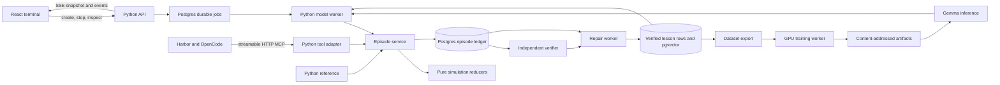

# Renaissance Runbook

## Engineering specification for Junction 2026

**Product:** A terminal for running AI agents through changing operational worlds, replaying their decisions, and training a small agent on simulator-verified corrections.

**Primary challenge:** AfterQuery's Break the Agent. The submission must show a reproducible frontier-versus-reference gap, explain the decisions behind it, and let judges independently verify the reward.

**Working decisions:** Python owns simulation, tools, evaluation, data, and training. React owns rendering and input. Harbor Master is the official benchmark candidate. Print Guild and Festival Quartermaster are two additional environments. Gemma 3 1B IT is the starting trainable checkpoint. These are build choices for this specification.

**Status:** Proposed specification. Commands, example records, values, targets, and annotated traces below are design material until implemented and run. A frontier gap and a training gain are hypotheses.

## Contents

1. [Product and challenge goals](#1-product-and-challenge-goals)
2. [Architecture and stack](#2-architecture-and-stack)
3. [Simulation and tool protocol](#3-simulation-and-tool-protocol)
4. [Harbor Master](#4-harbor-master)
5. [Print Guild](#5-print-guild)
6. [Festival Quartermaster](#6-festival-quartermaster)
7. [Generation, difficulty, and scenario library](#7-generation-difficulty-and-scenario-library)
8. [Scoring and verification](#8-scoring-and-verification)
9. [Reference policies and official evaluation](#9-reference-policies-and-official-evaluation)
10. [Persistence, jobs, and deployment](#10-persistence-jobs-and-deployment)
11. [Model adapters and sponsor features](#11-model-adapters-and-sponsor-features)
12. [Failure analysis and data production](#12-failure-analysis-and-data-production)
13. [Gemma training and model improvement](#13-gemma-training-and-model-improvement)
14. [Terminal and Environment Dictation](#14-terminal-and-environment-dictation)
15. [Operational plan and judging](#15-operational-plan-and-judging)
16. [Minimum reference implementation](#appendix-a--minimum-reference-implementation)
17. [Data storage recipes](#appendix-b--data-storage-recipes)
18. [Experiment worksheets and statistical analysis](#appendix-c--experiment-worksheets-and-statistical-analysis)
19. [Decision log and scope gates](#appendix-d--decision-log-and-scope-gates)
20. [Training and inference implementation notes](#appendix-e--training-and-inference-implementation-notes)
21. [One candidate benchmark instance worth implementing](#appendix-f--one-candidate-benchmark-instance-worth-implementing)
22. [Concrete first-weekend scenario and score sheet](#appendix-g--concrete-first-weekend-scenario-and-score-sheet)

## 1. Product and challenge goals

### Product flow

A benchmark engineer chooses a world and a model in the terminal. The center shows a Renaissance city operation in progress. The right pane shows the actual observations, notices, actions, and tool results. The lower tray shows deliveries, cost, deadlines, baseline comparisons, and the final verifier result. The user can replay a decision and inspect the evidence that preceded it.

After a training run fails, the platform identifies promising decision points and tries legal alternatives on isolated copies of the world. It stores the verified corrections and can export them to train Gemma. A user can load the resulting checkpoint and put it through the same held-out test as the base model. A demo operator can follow the chain from an individual failure to the dataset and adapter.

### Audience and problem

Agent evaluation teams need to tell whether poor outcomes come from the model, the harness, or the scorer. A final text answer alone tends to conceal the distinction. Operations teams face an analogous problem when an agent reacts to a changing supply, schedule, or dispatch workflow. The benchmark exercises that decision pattern in a controlled environment. A result in the simulation supports a claim about the evaluated task distribution.

### Submission tests

| AfterQuery criterion | Experiment | Judge evidence |
|---|---|---|
| Gap · 30 | Reference and three frontier attempts under the event protocol, plus a larger paired panel if available. | Actual scores and traces per attempt, exact task package and provider configuration. |
| Meaningful difficulty · 30 | Isolate the decision whose consequences follow from visible constraints. Compare disrupted and undisturbed controls. | Notice and observation, action, legal alternative, rollout results, independent reference. |
| Reward integrity · 25 | Compare complete, partial, idle, early exit, and incorrect-but-busy episodes. Recompute from accepted transitions and receipts. | Explicit reward formula, trusted ledger, fixed invariant cases and generated checks. |
| Craft · 15 | Fresh setup and one documented live evaluation command. | Docker/task definitions, dependencies, reproduction manifest, bundled replay. |
| Stretch | Base Gemma versus an adapter trained on simulator experience. | Frozen splits, source row and training lineage, held-out paired measurements. |

A good demo can explain one failed decision in under a minute. For instance, there was one alternate canal with enough transit time and one early departure slot. Giving that slot to later cargo meant the urgent cargo could no longer arrive on time. The toolkit should let the judge inspect each premise.

### Release order

| Release | Whole slice to deliver | Evidence it works |
|---|---|---|
| R0 | Harbor reducer, generated manifests, reference, independent verifier and baselines. | Run an exact fixture and a generated suite from Python. |
| R1 | Harbor/OpenCode via MCP and live terminal via event stream. | Same final score reached by harness, replay, and UI. |
| R2 | Corrections, dataset export, one real Gemma adapter, paired held-out report. | One lineage walkthrough, plus a clean analyst-free evaluation. |
| R3 | Nemotron multimodal action path and Gemini repairs plus scenario drafting. | Observe input to tool action and validated outcome for each model. |
| R4 | Print and Festival playable via shared protocol. | One independently scored scenario family and reference per world. |

Start R2 and model capability checks in parallel with R0. Keep R4 off the critical path. If the target frontier reaches the reference on every dev instance, increase decision coupling before freezing the official task distribution. The actual outcome of a frozen panel stays in the report.

## 2. Architecture and stack

### Service topology



The engine is a plain Python library. It has no imports from database, web, provider, GUI, or ML code. The same engine runs in local checks, the live service, and repair forks. The verifier uses the world contract and event types to independently account for objective completion, while replay uses the reducer for exact state reconstruction. Use both during verification so the grader is not a duplicate invocation of live reward logic.

### Proposed stack and tradeoffs

| Layer | Choice | Decision rationale and implementation constraint |
|---|---|---|
| Runtime | Python 3.12 as initial target | Validate a second Python version only if pinned organizer or GPU dependencies need it. Separate training lockfile/image from API. |
| Packaging | uv, pyproject, lockfiles | Pin Python and dependencies. CI and judge bootstrap use locked installs. |
| Types | Python dataclasses for immutable runtime data, Pydantic v2 for trust boundaries | Validate strict integers, enum types, finite serialized values, and schema versions. |
| API | FastAPI, Uvicorn, official Python MCP SDK | REST for operator requests, Streamable HTTP for model tools. Smoke-test mounting and lifecycle with the pinned MCP SDK. |
| Database | PostgreSQL, psycopg 3, SQL migrations, pgvector | Transactions for actions and receipts. Exact vector search first. |
| Jobs | Postgres-backed worker with leases and heartbeats | Queue, retries, and artifacts can be persisted without another service. |
| UI | Vite, React, TypeScript, CSS grid, Canvas or DOM tiles | React renders snapshots and events. One world renderer per domain. Use Pillow to produce canonical model-facing board images from the same public projection. |
| Provider calls | Python OpenAI-compatible client for NVIDIA, Google GenAI SDK, isolated Gemma endpoint | Normalize provider messages and keep adapter-specific settings explicit. |
| Reference | Python enumeration and memoization for small worlds | Search actual legal actions. Optional CP-SAT for larger scheduling/allocation worlds. |
| ML | PyTorch, Transformers, PEFT, TRL or explicit assistant-only masking with Trainer | Start with LoRA on a small instruct checkpoint. Pin training and inference revisions. |
| Embeddings | Versioned local sentence encoder behind a Python interface | Normalize decision features. Store encoder, revision, dimension, and input hash. Small datasets use exact cosine ranking. |
| Validation | pytest, Hypothesis, Ruff, type checker, one browser smoke flow | Property-test core invariants and run the full judge path from a clean checkout. |
| Deployment | Docker Compose locally, separate Linux GPU job | Local Postgres and isolated services for judges. Copy only approved manifests and adapters to GPU storage. |

Use primary library docs during implementation. The exact API/model and dependency versions belong to the measured run manifest. [Harbor tasks](https://docs.harborframework.com/tasks/overview), [OpenCode MCP](https://opencode.ai/docs/mcp-servers/), [pgvector](https://github.com/pgvector/pgvector), [PEFT LoRA](https://huggingface.co/docs/peft/en/package_reference/lora), [TRL SFT](https://huggingface.co/docs/trl/sft_trainer)

### Suggested repository structure

```text
src/runbook/
  contracts/
    actions.py
    observation.py
    events.py
    scenario.py
  worlds/
    harbor/
      charter.py
      generate.py
      rules.py
      render_data.py
      policy.py
    print_guild/
    quartermaster/
  runtime/
    episode.py
    repository.py
    replay.py
    budgets.py
  api/
    app.py
    mcp.py
    runs.py
    streams.py
    drafts.py
  providers/
    base.py
    nvidia.py
    gemini.py
    gemma.py
  benchmark/
    control_policies.py
    verify.py
    harbor_package.py
    aggregate.py
  learning/
    detect.py
    fork.py
    repair.py
    lessons.py
    split.py
    export.py
    train.py
    evaluate.py
  worker/
    jobs.py
    play.py
    publish_training.py
web/
migrations/
harness/
tests/
  unit/
  properties/
  contracts/
  benchmark/
  integration/
docs/
```

Move a boundary when it reduces work. For example, put several small runtime modules in one file until they need to evolve independently. Preserve the pure simulation boundary and keep replay, score verification, and model adapters separately testable.

### Main data paths

1. **Start.** Operator selects a registry model, scenario family, and run profile. API validates the request and materializes a scenario. A committed episode row stores the realized manifest and planned runner configuration. A job claims it, or a harness caller receives an episode credential.
2. **Observe.** The agent reads the public projection. Store exactly what was delivered, including logical document revisions or canonical image hash. Per-run observations have stable event IDs. The right-hand UI can display them after the agent has seen them.
3. **Act.** The model emits a tool call. The runtime authenticates actor and episode, validates the message, applies one batch, and commits the new revision with events. Persist errors with distinguishable causes.
4. **Close and verify.** The runtime freezes state at a terminal boundary. The verifier consumes authorized immutable inputs and publishes a versioned verdict. The result describes pending work and why the episode closed.
5. **Learn.** Eligible training episodes go through detection, fork verification, lesson creation, export, training, and held-out evaluation. The UI obtains provenance by IDs linking every stage.

## 3. Simulation and tool protocol

### Formal environment

A scenario instantiates an episodic partially observable environment. Let the public charter be C, the realized exogenous event schedule be E, and the initial state be S0. The reducer applies valid domain actions to S and advances simulation time. An observation function projects S and the released prefix of E. The remaining schedule is part of hidden simulator state. Uncertainty comes from future notices and other explicitly disclosed mechanics. All current constraints required to act are available through the observation interface.

| Variable | Meaning |
|---|---|
| r | Simulation round, initialized to 0. |
| H | Final observable round, inclusive of arrivals due at H. |
| v | Monotonic world revision, used for optimistic concurrency. |
| seq | Monotonic event sequence, including read, lifecycle, and rejected events. |
| E | Immutable materialized notices and world changes. |
| A | Accepted decision actions and generated effects. |
| R | Terminal verifier reward. |
| O | Observation with version, round, rules, current facts, and lookup references. |

### Round semantics

1. The initial state is at round 0 and revision 0, with all notices effective at 0 applied and visible.
2. Reads and inspect calls are side-effect-free for world state and can produce audit events. Read allowance is a separate counter. Reads do not move the clock.
3. A successful `commit` or `wait` at r closes the current decision round. Batch validations and departure effects use the state at r. All operations are applied to a candidate state in published order.
4. The engine advances to r + 1, settles scheduled arrivals/completions under their domain's rules, applies effective notices in stable order, and emits the new observation state. A revision notice can supersede eligible work for later decisions. A delayed shipment is implemented with a declared effective phase and stable scheduling rule.
5. If r + 1 equals H, settle everything due at H, then close. Actions may start at 0 through H - 1. Due rounds are inclusive. A `finish` at any open revision closes immediately with no hidden advancement.
6. An invalid attempt is logged. It moves neither the clock nor world revision. It consumes one attempt allowance, subject to idempotent retries. Attempt exhaustion closes at the current world revision. Accepted decisions advance the world revision once, including an explicit finish. External close on timeout or operator stop freezes the existing world revision and records the lifecycle change in the event sequence. The post-decision public observation can be included in the response without a further read.

**Commit ordering:** Preserve the exact submitted order for operations inside one batch. Each operation sees candidate state after previous operations. One invalid operation aborts the batch including earlier operations. Atomicity allows release-and-rebook in a single decision, with preconditions rechecked against the candidate state. Every timing example and reference policy uses this rule.

**Notice ordering:** Define a fixed priority by notice kind and then stable notice ID. Avoid contradictory same-target notices unless a family explicitly defines precedence. Preserve published notices as versioned records with an effective round and public change description. Announcement and effect share a round for MVP. Later versions may expose a forecast with a clear validity window.

**Budgets:** Start dev calibration with 6 decision rounds and 24 read calls plus 12 mutation attempts. Limit a batch to 4 operations, require finite and bounded integer arguments, and publish limits in the charter. Count application validation failures once. Transport retries with the same key count once. Provider timeouts use a wall-clock ceiling independent of the simulated clock. Calibrate with realistic harness timeouts before freezing configs.

### Domain protocol

```python
class World(Protocol):
    def generate(self, spec: ScenarioSpec, seed: int) -> Manifest: ...

    def initialize(self, manifest: Manifest) -> WorldState: ...

    def observe(self, state: WorldState, charter: Charter) -> Observation: ...

    def inspect(
        self,
        state: WorldState,
        target: InspectionRef,
        view: InspectionView,
    ) -> PublicDocument: ...

    def advance(
        self,
        state: WorldState,
        decision: Decision,
        schedule: NoticeSchedule,
    ) -> Transition: ...
```

Types above are illustrative. In implementation, each world has typed state and action payloads. `advance` owns pure domain effects. Session caps, idempotency, attempt limits, and actor authentication belong to the runtime. Do not pass a complete private state object to renderer or policy functions in production. Build narrow public DTOs first.

### MCP tools

| Method | Inputs | Response | Purpose |
|---|---|---|---|
| `observe` | `view` optional, default compact | Latest public revision and round | Access work, resources, effects, and limits. |
| `inspect` | Public `kind`, `ref`, `view` | Revision, structured data or image, date/evidence ID, related refs | Access deeper facts such as routes and calendars. |
| `commit` | `expected_revision`, `action_id`, typed operations | Accepted or rejected, events, public current observation | Apply one batch. |
| `wait` | `expected_revision`, `action_id` | Same response shape as commit | Advance exactly one round without starting work. |
| `finish` | `expected_revision`, `action_id` | Terminal reason, state version and verification status | End without moving time. |

OpenCode and the interactive worker share these domain operations. Avoid making the model manufacture UUIDs. A string of bounded length is sufficient for the tool-level action ID. Where the transport provides a stable call ID, the adapter can map it to the episode idempotency key. Distinguish the idempotency key from the proof or evidence IDs.

```json
{
  "expected_revision": 2,
  "action_id": "round-2-dispatch-cloth",
  "operations": [
    {
      "type": "reserve_berth",
      "vessel_id": "barge-a",
      "dock_id": "east",
      "arrival_round": 4
    },
    {
      "type": "dispatch",
      "vessel_id": "barge-a",
      "route": ["outer-canal"],
      "loads": [{"job_id": "cloth-east", "units": 4}]
    }
  ]
}
```

Identifiers are scoped to the episode. A dispatch resolves the vessel's matching reservation by dock and arrival round. The server creates its own immutable movement and receipt IDs. A single round can contain operations for multiple vessels. A vessel can have at most one active held arrival reservation or one allocated arrival slot. Deadheading needs an empty loads array and a booked destination berth.

### Error semantics

| Code | State effect | Agent remedy |
|---|---|---|
| `invalid_request` | No world mutation. Bound the invalid-attempt cost before parsing expensive payloads. | Read schema and correct shape. |
| `stale_revision` | No world mutation. Return the current revision. | Observe and reconsider. |
| `route_unavailable` | No world mutation. | Inspect route and current notice. |
| `resource_conflict` | No world mutation. | Inspect capacity and release through a legal operation. |
| `incompatible_inventory` | No world mutation. | Inspect eligibility and substitute policy. |
| `idempotency_conflict` | No world mutation. Record repeated conflict diagnostics in a bounded manner. | Create a new action ID for the new decision. |
| `episode_closed` | Final state retained. | Read the terminal summary. |
| `budget_exhausted` | Close if required by the public budget law. | Read terminal reason. |
| `service_unavailable` | Roll back uncommitted transition or recover by key. | Retry with same key if eligible. |

Return stable error paths and public facts. A rejection may point to an already visible notice. An agent can use the rejection to recover, and the trace preserves the failed attempt. A charter that disallows invalid attempts outright makes syntax errors dominate the benchmark, so prefer a published allowance with bounded recovery.

## 4. Harbor Master

### Brief and win condition

Move required cargo from chartered source docks to named destination docks by integer deadlines. Control barges of different sizes and drafts. Routes have travel times, cost, draft eligibility, and a public effective state. Reserve scarce arrival berths and revise the dispatch plan when routes close or capacity changes. Every boat and unit is accounted for.

Use one city map in the first release, three or four docks, two or three barges, two or three jobs, up to about eight route edges, and 5–8 decision rounds. Make closures work before adding every notice family.

### State records and invariants

| Record | Important fields | Invariant |
|---|---|---|
| Dock | ID, berth capacity by arrival round, loadable cargo lots | Capacity is an integer count of arrivals, not a continuous queue. |
| Route edge | Source, destination, duration, cost, draft ceiling, entry capacity, availability | Directed endpoints. Duration at least one. |
| Barge | ID, cargo capacity, draft, dock or in-transit move ID | One location state at a time. |
| Charter job | Source, destination, lot, required units, due round, weight | Demand > 0. Allocations belong to the job and physical lot. |
| Cargo lot | Physical ID, source, available units, unit type | Opening + acquired = at source + in transit + arrived + explicit writeoffs. |
| Move | ID, vessel, booked route, cargo allocations, depart, arrive | Once dispatched, route and arrival commitment are fixed in V1. |
| Berth slot usage | Dock, round, vessel, held/allocated state | Count of active claims ≤ capacity. |
| Route entry usage | Edge, entry round, move | Total committed transits for each entry key ≤ capacity. |
| Receipt | Move, job, physical allocation key, destination, round, units | Generated once at arrival, counted once by verifier. |

For V1, cargo units are interchangeable within a lot. Jobs may share the lot but draws must decrement physical inventory. Track delivered, in-transit, and remaining eligible allocations per job. Shipping more than the remaining demand can be rejected as an unnecessary invalid operation in V1. Cost uses all accepted movements, including empty repositioning and legitimate movements arriving late.

### Legal moves

**Reserve berth.** An idle vessel may hold one arrival slot at a future round within H. Reservation locks one unit of public capacity. An idle vessel may replace its hold only by releasing the old reservation first, including in the same batch. A hold carries no fulfillment credit. Holds expire when their arrival round settles.

**Release berth.** Free an unused held reservation. A committed voyage owns its allocated berth until settlement. A later capacity notice may reduce only unallocated future capacity under published V1 semantics. Announce any change before new commitments. A family that displaces in-flight arrivals would require a different charter and explicit redirection tools.

**Dispatch.** Build a path from the vessel's current dock to the destination. Require path continuity, valid unique edges within the configured path cap, available routes under current constraints, draft compatibility, correct berth and horizon, and enough physical and per-job remaining units. V1 commits legal use of every entry slot on the route when it departs. Later route notices affect new trips. Compute cost and arrival from the manifest and path. Debit source inventory and accepted cost in the same transition. Convert the held berth to allocated.

**Wait / finish.** Waiting can allow arrival or changing availability. Finish counts only receipts already settled. An optimal agent can finish early if every job has already arrived and no further objective remains.

**Notice API.** A canal closure publishes changed edge status plus the exact effective round. A tide notice changes maximum draft for subsequent dispatch. A capacity reduction preserves already allocated arrivals. A reopening explicitly restores published eligibility. Scenario authors can combine these if recovery remains possible under the public action budget.

### Exact sample arithmetic

This is a hand-computed rule fixture and a teaching example. It does not count as a frontier result.

| Parameter | Value |
|---|---|
| H | 5 |
| Opening stock | Cloth 4, grain 3, both at West |
| Barges | A capacity 4, B capacity 3, both at West |
| Deliveries | Cloth to East by 4, grain to North by 5, equal objective weight |
| Short canal | West → East, 1 round, cost 2, open initially, closes at round 2 |
| Outer canal | West → East, 2 rounds, cost 6 |
| North route | West → North, 2 rounds, cost 3 |
| Slots | East at 4, North at 4 and 5, each capacity 1 |
| Quality bounds | Spend cap 15, slack cap 2 |

Treat the fixture as an observed round-2 snapshot generated by two preceding waits. The solver and agent both get that snapshot for a decision test. The full benchmark starts at round 0.

```text
Observed at 2:
  short canal closed
  cloth 4 due East at 4
  grain 3 due North at 5
  A capacity 4, B capacity 3, both idle at West

At 2, four-operation batch:
  reserve East/4 for A
  dispatch A on outer canal with cloth 4
  reserve North/4 for B
  dispatch B on north route with grain 3

At 3:
  both vessels in transit
  wait

At 4:
  receipt (cloth, East, 4, round 4)
  receipt (grain, North, 3, round 4)
  finish
```

```text
P = 1
cost_quality = 1 - 9 / 15 = 0.4
slack_quality = (4 × 0 + 3 × 0.5) / 7 = 3 / 14
Q = 0.6 × 0.4 + 0.4 × (3 / 14) ≈ 0.325714
R = 0.70 + 0.30 × Q ≈ 0.797714

If only the grain receipt arrives before close:
P = 0.5
R = 0.15 × 0.5 = 0.075
```

The example shows why a high-volume partial run ranks below a tight complete run. A variant with an earlier usable berth can allow a dispatch before the closure. That early delivery is legitimate and can outperform the round-2 example. A family intended to force reactive replanning should put cargo release, berth availability, or revealed state in the right round rather than relying on agents to voluntarily wait.

### Evolution beyond the first pass

- Add cargo availability rounds with an explicit release notice. Guarantee a clear observation and legal loading after release.
- Add two-hop journeys where berth/entry capacity creates a reason to plan ahead. Limit paths at first to keep enumeration practical.
- Add draft restrictions that make one barge uniquely capable of a job. Large-versus-small capacity then interacts with compatibility.
- Add a route reopening so conservative waiting can be correct on disclosed conditions.
- Track changing departure eligibility per round. Keep in-flight commitments immutable until the team implements a complete rescheduling rule.

### Harbor failure signatures

| Signature | Observation needed | Observable consequence |
|---|---|---|
| Stale route | Closure precedes rejected dispatch. | Retry budget consumed, no movement. |
| Wrong cargo priority | Both deadlines, eligibility, and barge capacities are visible. | The last valid departure for urgent cargo disappears after assigning its only vessel elsewhere. |
| Arrival overcommit | Current berth calendar and ETA comparison are available. | Batch rejected or cargo forced onto a later, infeasible itinerary. |
| Deadline arithmetic | Route duration and due-round rule available. | Legal low-cost trip arrives after due round. |
| Inventory overclaim | Remaining physical lot and job quantity visible. | Invalid second booking, or stock stranded after a poor split. |
| Premature finish | Active voyage arrival and current round visible. | No receipt yet, low score despite a text claim of success. |

## 5. Print Guild

### Decision under test

Schedule production stages with precedence and shared resources. During execution, a client revises an edition or a press goes out of service. The agent must decide which work can continue, which reservations to release, and what can still finish. The transferable skill is repairing a schedule while honoring upstream and downstream commitments.

### State and time

| Entity | Fields and interpretation |
|---|---|
| Commission | Active revision, reveal round, due round, format, quantity, allowable paper grades and ink. |
| Edition revision | Versioned specification, reusable settings, predecessor and compatibility on supersession. |
| Stage token | Commission, revision, stage, quantity, proof result, availability round. |
| Worker and machine | Capabilities and occupancy calendar, including announced downtime. |
| Materials | Paper and ink lots, counts and compatibility. |
| Batch | Edition revision, size, stage, assigned resources and start/end rounds. |
| Receipt | Dry, approved copies for a specific commission revision. |

Start with one typesetter, one proofreader, two presses with distinct format support, and two drying racks. Use discrete stage durations in whole rounds. A reservation claims resource capacity over a half-open interval `[start, end)`. A finished output becomes eligible before the next decision at its end round. A stage uses the approved predecessor token and the active revision when applicable. Parallel work on the same commission is permitted if its claimed units and dependencies are distinct.

### Actions and revision effects

- `start_typesetting(commission, revision, station)` schedules a stage token. Opening consumables are debited if required.
- `approve_proof(commission, revision, proof_ref, worker)` claims proofing capacity and produces a proof token when complete. Inspecting the proof reveals the relevant check. Early versions can make all proofs deterministic and correct if built from the correct revision.
- `print_batch(commission, revision, quantity, press, drying_rack)` requires an available proof, compatible equipment and sufficient materials. It atomically reserves press and rack intervals and debits input lots. Drying starts when printing ends and releases eligible copies when complete.
- `release_slot(reservation)` releases future unused holds. Consumed materials stay consumed. V1 committed stages finish on schedule.
- `reserve_slot(resource, start, end, commission)` blocks a future interval for its owner. Optional if automatic rack booking gives enough decision coupling.
- `wait` advances the world to the next choice.

A revised commission defines the active revision, an effective round, and any allowed reuse explicitly. The generator should avoid superseding accepted final receipts in V1. Release revisions while affected editions remain undelivered. In-progress obsolete batches occupy the resources they committed. Their output is recorded as obsolete and earns zero final credit. An optional revision may reuse typeset layout and require a new proof. Treat that as part of the public notice.

### Example case and reference

At round 2, a 12-copy broadside revision requires the wide press. The guild has already typeset it. A 5-copy small-format job due at round 6 can use either press. New capacity leaves the wide press available only at rounds 3 and 4. The correct plan may start proofing the large order at round 2 while assigning the small order to the narrow press later. The agent can inspect the revised approval and both calendars. A model that uses the wide press for the small order simply because the resource was first on the list can foreclose the large order. Set actual proof, print, dry, and due-round values in the test manifest and validate them through enumeration.

The reference performs a bounded search over stage starts and wait. Use a canonical state key including inventory, remaining quantities, active revision, stage outputs, and occupancy. Sort candidate starts by earliest downstream deadline and distinguish scarce-resource windows. Prune only with sound lower bounds. Compare to exhaustive search on reduced instances before trusting pruning on the official suite.

### Score inputs and acceptance

- Each required commission counts eligible settled units capped by demand. Include revision and batch eligibility.
- For fully valid completion, quality is a public weighted combination of low total material waste and deadline slack. Count consumed materials in obsolete and discarded batches.
- A pipeline improvement means final editions arrive more often or with less waste. Press utilization is diagnostic telemetry.
- Integration acceptance requires revision updates, press/rack conflict rejection, visible reasons for rejected actions, and two different legitimate complete schedules with scores computed from their outcomes.

## 6. Festival Quartermaster

### Decision under test

Allocate scarce supply to venues with differing compatibility and deadlines. The model must keep flexibility for future obligations while responding to revised deliveries or demand. This tests opportunity cost and coordination across a purchase, transfer, and delivery workflow.

### State records

| Entity | Fields |
|---|---|
| Venue | Location, opening round, requirements and accepted substitutions. |
| Stock lot | Lot ID, material grade, usable units, location or transit, reserve class. |
| Supplier quote | SKU, guaranteed quantity, per-unit cost, ready round, availability, destination warehouse. |
| Route | Source, destination, fixed round cost, cart capacity, restrictions. |
| Order | Quote revision, units purchased, money debited, pending arrival. |
| Transfer | Cart assignment, allocated lots and source/destination, arrival. |
| Delivery | Venue, accepted demand line, lot units transferred, receipt round. |

Use integer money and stock units. Buying schedules receipt at a warehouse. A lot scheduled for arrival cannot be loaded before it settles. Once dispatched, a cart can handle no other transfer until arrival. No inventory reappears when a hold is canceled after the material left its source.

### Actions

1. `purchase(quote_id, revision, units)` commits price from the current quote and creates pending stock. Debit the shared wallet. A later quote revision applies to new orders.
2. `hold_units(lot_id, venue_id, units)` claims available units at their current location. Holds do not fulfill requirements. The simplest playable version can skip holds and rely on atomic transfers.
3. `release_hold(hold_id)` releases any unused remainder.
4. `dispatch_transfer(cart_id, source, destination, loads)` moves available stock around the map. Enforce compatibility, capacity, and reserve floors.
5. `accept_delivery(venue_id, demand_id, lot_id, units)` consumes available stock already present at the venue. If loading and acceptance in one action is needed for usability, document the precise conditions and receipt phase.
6. `wait`, `finish`, `observe`, and `inspect` use shared semantics.

A reserve floor is a hard operational restriction. Evaluate it on the available reserve stock that the policy defines. For V1, make the definition simple: designated units physically at the central warehouse and uncommitted for transfer, with narrow explicitly qualified classes. A purchase order has no effect on the floor until settled. An attempt that would violate the floor is rejected.

### Worked choice and reference

A conservatory needs six units of linen grade A. A stage accepts linen A or B. There are six A and six B units. The six A units are the only eligible ones for the conservatory. If otherwise feasible, a local choice to use A for the stage can make full fulfillment impossible. A more difficult variant holds B at the riverside warehouse, with one cart that can move it only if another order is released. The agent can see grade compatibility, stock, and travel times. Add a matched control where the conservatory accepts grade B and compare whether the model reserves premium stock only when necessary.

Reference starts with an integer allocation across eligibility edges, then expands feasible purchases, transfers, and receipts in time. On small instances, exhaustive action enumeration is adequate. Precheck obvious impossible demands with bipartite matching, accounting for distinct physical units. Keep capacity over time in the reference search. Allocation alone cannot certify an achievable schedule.

### Score inputs and acceptance

- Credit eligible venue receipts, capped per demand line, by its opening deadline.
- Retain an auditable rule for equivalent substitutions and conversion ratios. Restrict MVP conversion to one-to-one.
- Total cost includes all accepted purchases and paid transfers. Quality may include slack and committed excess stock when expressed with a public cap. Choose a single score version before judging.
- Test empty purchases, overlapping holds, duplicated transfer IDs, late receipts, reserve boundary cases, and conflicting demand assignments.

## 7. Generation, difficulty, and scenario library

### Scenario identity and construction

A seed only becomes reproducible when combined with generator version, normalized request, and the realized manifest. Store all inputs. A replay opens the materialized manifest to avoid dependency on generator implementation or random draw ordering.

```text
ScenarioRequest
    environment: harbor
    template: closure_and_scarce_berth
    difficulty_band: medium
    allowed_dials: validated typed map
    source: curated | generated | dictation
    generation_seed: integer

ScenarioManifest
    scenario_id and content_sha256
    manifest_version / generator_version / sim_version / score_version
    normalized request / concrete seed
    initial state, charter, public horizon
    private post-start events and phase ordering
    topology_signature / causal_family / surface_variant
    split
```

Generate in layers. Draw topology, opening resources and demand, then temporal constraints and exogenous notices. Keep outcome independent of provider calls and names. Assign actual route and tool labels after structural choices. Persist canonical sorted representations for hashes. For reproducibility, pin the serialization implementation, normalize keys and ordering, prohibit NaN and Infinity, and preserve list order where it affects transitions. Exclude epistemically irrelevant metadata such as run IDs and creation timestamps from scenario identity.

### Feasibility pipeline

1. Check schema and per-edge legal bounds.
2. Check reachability, job positivity, resource feasibility lower bounds, horizon, and a baseline of ordinary route compatibility.
3. Run a private, development-only full-information search on reduced worlds to reject impossible manifests. This search may use the realized schedule. Its actions never become the official reference trace.
4. Run the ordinary reference with observed facts only and confirm it can complete within the published budgets. Log the gap between full-information upper bound and policy score as a design diagnostic.
5. Run no-op and a fixed early-stop prefix. Reject trivial families where the opening state already satisfies objectives or automatic arrivals do most of the work.
6. Check for more than one candidate at the intended turning point and ensure a meaningful consequence separates feasible actions.
7. Deduplicate by identity and structural signature. Memoize validation for repeat imports.
8. Accept or return an explicit failure reason after a bounded number of generator attempts. Never loop indefinitely or silently relax constraints. Log rejected counts so the evaluated distribution is understandable.

Scenario acceptance can depend on feasibility and the aim of the family. Freeze it before official test inference. Tune difficulty from development runs and carry the selected constraints forward transparently.

### Challenge dials

| Mechanic | Easy | Medium | Hard, with feasible slack |
|---|---|---|---|
| Notices | Stable world | Single notice affects one decision | Coupled capacity and eligibility updates |
| Candidate plans | One straightforward feasible route | Several feasible orders with different tradeoffs | An early action removes the only later feasible plan |
| Resource coupling | Each job has its own resource | One shared bottleneck | Two linked bottlenecks with independently visible facts |
| Memory | One concise observation | Relevant earlier booking retained across turns | Meaningful cross-document dependency with revisions |
| Recovery | No repair needed | Release and rebook | Preserve part of old plan and revise only the affected tasks |
| Time | Wide deadlines | One narrow window | Tight deadlines across competing commitments |
| Quantity | Unsplittable single loads | Partial loads for one job | Shared physical lots, split deliveries and different due rounds |
| Observability | Single structured board | Optional inspect for details | One or two focused reads link rule and opportunity |

Attribute score changes to model decisions with matched controls. Compare the same starting topology with and without closure, same closure with wide versus tight slack, and same job with different ordering and names. Calibrate with frontier traces on dev cases. A challenge that starts with unsupported media, opaque tool names, malformed state, or impossible deadlines measures something different from planning.

### Harbor library

| Scenario | Generated change | Key evidence | Expected skill and paired control |
|---|---|---|---|
| Closed shortcut | Close a cheap short path after release of a cargo. | Notice round, ETA, outer route. | Replan. Control leaves it open. |
| Low tide | Lower draft ceiling independently of capacity. | Barge drafts and edge max. | Use compatible vessel. Control raises max. |
| Last berth | Reserve or remove one future unallocated slot. | Berth calendar and all ETAs. | Protect a narrow arrival slot. Control adds one. |
| Split cargo | Demand exceeds largest capacity while two slots exist. | Load cap and remaining job quantity. | Split physically and count each unit once. |
| Premature bulk trip | Later job can take shared vessel today or alternate tomorrow. | Availability and deadlines. | Dispatch urgent job first. |
| Compound notice | Shortcut closure and North berth loss. | Two distinct evidence records. | Update both dependent constraints. |
| Reopening | Restore route after a known restrictive interval. | Current notice and explicit window. | Reconsider conservative plan. |
| One-way canal | Return edge differs and repositioning costs extra round. | Directed map and departure starts. | Plan return and empty move. |
| Late release | Stock becomes loadable at round 2. | Public cargo release notice. | Distinguish stock existence from loading availability. |
| Unused hold | A vessel holds a now-unhelpful reservation. | Hold state and release rule. | Release and commit shared slot atomically. |
| Cost tie | Several complete routes differ in fuel/spend. | Published quality and route costs. | Prefer efficient successful plan. |
| Board modalities | Same facts as image and structured text. | Canonical evidence parity hashes. | Measure visual grounding separately. |

### Print library

| Scenario | Generated change | Key evidence | Expected skill and paired control |
|---|---|---|---|
| Superseded text | Revision invalidates old proof. | Active version and stage token version. | Reproof before printing. |
| Reusable type | Revision retains format but changes text. | Reuse rule. | Retain allowed work and discard obsolete proof. |
| Press outage | Restricted press downtime intersects one slot. | Machine calendar and compatibility. | Retime only affected work. |
| Shared type | Two jobs need same non-duplicated type set. | Occupancy and release times. | Schedule precedence and reuse. |
| Drying bottleneck | Press capacity exceeds rack capacity. | Rack availability and output timing. | Plan downstream before starting. |
| Material spoilage | Opening stock or later available lot is reduced by notice. | Remaining paper, alternative grades. | Reallocate or downsize batch. |
| Wide press | Only one edition needs a wide press. | Bidirectional compatibility table. | Preserve scarce fit for constrained job. |
| Proofreader window | One proofreader becomes available ahead of forecast. | Current labor card. | Use opportunity before deadline. |
| Unit caps | Overproduction cannot raise credited quantity. | Demand and existing dry receipts. | Finish the actual required batch mix. |
| One-late edition | A full schedule competes with fast partial response. | Due horizons and objective weights. | Complete all commitments. |

### Festival library

| Scenario | Generated change | Key evidence | Expected skill and paired control |
|---|---|---|---|
| Shared substitute | Only one guild accepts all grades. | Compatibility rows. | Preserve narrowest grade. |
| Supplier delay | Cheap supplier slips beyond opening. | Current quote revision and transfer ETA. | Recalculate total lead time. |
| Reserve floor | Small central emergency stock becomes protected. | Floor policy and active commitments. | Preserve usable reserves. |
| Cart contention | One cart can service several destinations but takes longer for one. | Occupancy and route durations. | Sequence dispatch. |
| Ward demand change | Planned destination needs less after public update before delivery. | Demand revision and stock locations. | Redirect available stock through legal path. |
| Staggered opening | Different venue deadlines. | Opening schedule. | Allocate slack across orders. |
| Split supplier lots | Two quotes deliver complementary quantities. | Stock by arrival and warehouse. | Combine legal lots without double-credit. |
| Volume discount | A bundled lot saves unit cost but crowds out needed purchases. | Total budget and exact demand. | Optimize delivered requirements first. |
| Pending versus delivered | Supplier arrives before opening but transfer would be late. | Distinct order and delivery events. | Account for last mile. |
| Destination mismatch | Two guilds need identical units at distinct locations. | Destination receipt keys. | Track actual fulfillment. |

### Picking scenarios to take into production

Start with harbor closure and one reserve contention family. Choose the first family where a frontier dev failure has a clean explanation and a public-information reference repeatedly succeeds. Keep a judge coverage table with scenario ID, novelty axis, solver success, target turning point, and all run scores. Keep variants where a flexible model succeeds. Expand the official set before freeze only if the organizers allow a multi-scenario panel. Playable UI worlds can have broader exploratory distributions.

## 8. Scoring and verification

### Formal score

Let required job j have positive demand d_j, nonnegative credited quantity c_j, and positive weight w_j. Define:

```text
P = Σ_j w_j × min(c_j, d_j) / d_j
    --------------------------------
                 Σ_j w_j

Q = domain quality in [0, 1]

R = 0              for a scored trace that fails a critical invariant
  = 0.15 × P       if at least one required objective is incomplete
  = 0.70 + 0.30×Q  if all required objectives are satisfied
```

`c_j` includes only unique eligible settled units by deadline. Compute `complete` by comparing integer counters. Use rational or fixed-point arithmetic for deterministic artifacts, then serialize to the harness-required numeric form at the boundary. Preserve unrounded metrics and adopt one defined rounding scheme for display. Equal score on alternate successful plans is acceptable.

Proposed Harbor Q is 60% cost and 40% slack. Cost quality is `clamp(1 - committed_cost / cost_cap, 0, 1)`. Slack quality is the demand-unit-weighted mean of `clamp((due_round - receipt_round) / slack_cap, 0, 1)` across credited units. Caps are positive and materialized in the public charter. Derive cost caps from public ranges or fixed generator bands, and calibrate to avoid saturation. Compute cart spend, material waste, or analogous domain components using published definitions and matching fixed caps.

A run abandoned before settlement gains only work it actually completed. A fully completed run can finish before H and retain full score eligibility. Invalid actions alone cannot generate objective credit. An outcome with verified tampering or an invariant violation is a distinct scored integrity failure if the trusted trace supports that conclusion. A missing or corrupt trusted trace is an infrastructure error and requires investigation or an authorized retry. Do not impute an ordinary zero when no valid verdict exists.

### Verifier input and output

Independent grader inputs are materialized scenario, authenticated run identity, frozen ledger, terminal reason, and valid versions. Read from a trusted run service or verifier-owned artifact, not from the agent's working directory. Run pure replay for state hash validation. Run an independent accounting pass for physical quantities, receipts and score. Fail with an infrastructure reason on a missing required input, version mismatch, or failed decode. Interpret grader results only after the closure sequence is known.

```json
{
  "verifier_version": "harbor-verifier-v1",
  "state_hash": "sha256:<example>",
  "status": "scored",
  "terminal_reason": "finished",
  "reward": 0.075,
  "complete": false,
  "partial_fraction": 0.5,
  "quality": null,
  "obligations": [
    {"job_id": "cloth-east", "required": 4, "credited": 0},
    {"job_id": "grain-north", "required": 3, "credited": 3}
  ],
  "critical_checks": {
    "conservation": true,
    "valid_receipts": true,
    "consistent_replay": true
  },
  "trace_evidence": {"terminal_seq": 21, "receipt_seqs": [19]}
}
```

### Accounting algorithm

1. Initialize physical resource counts from the manifest. Validate IDs and positive demands.
2. Consume accepted action events in their exact order. Verify allowed start data, state boundaries, conservation changes, and linkage of commitments.
3. Compute eligible output from resource movements and leg/stage finish rules. Require one unambiguous receipt per unique allocation or derived lot.
4. Attribute each bound receipt to one eligible job line and aggregate; reject inconsistent receipt keys and illegal resource creation. Maintain separate counters for timing, destination validity, and completion eligibility.
5. Compare replayed terminal state hash, event chain continuity, accepted spend, and job counters to the frozen snapshot.
6. Compute reward and attach structured facts and evidence IDs. Repeat with the same verifier version to test byte-stable normalized verdict.

### Integrity test matrix

| Case | Expected verdict or observable behavior |
|---|---|
| All waits | Zero for positive unsatisfied opening work. |
| Inspect and text claim | Zero unless trusted rules delivered actual work. |
| Start trips then finish | Pending receipts excluded. |
| Stop after one valid receipt | Positive low partial score. |
| Full success at H | Normal reward with due rounds inclusive. |
| Full success and early finish | Normal reward using actual cost and receipts. |
| Duplicate committed action retry | First result returned once, no duplicate events affecting objectives. |
| Same key with changed payload | Conflict, original action unchanged. |
| Competing versions | One mutation can commit for a given revision. Losing caller receives fresh revision or closed status. |
| Wrong dock or job | No eligible receipt. Verify or reject at the domain boundary as defined. |
| Late arrival | Record physical delivery and cost, zero on-time credit. |
| Oversize or negative amount | Strict validation and no partial batch effect. |
| Canceled holds repeated | Capacity is restored at most once. Credit unchanged. |
| Distinct legal optimal plans | Each scored from its own receipts and cost. |
| Tampered snapshot versus replay | Inconsistency visible to verifier, no success verdict. |
| Model says reward is one | Grade unchanged. |
| Judge requests a separate run | Quarantined state and ledger per episode. |

Measure diagnostics separately: action validity, notice recovery, utilization, network calls, cost, queue time, and inference latency. UI can show provisional counts with a label. Only publish the terminal official reward after the verifier seals it. During learning, keep dense signals versioned and available to the training analyst unless the evaluated profile explicitly exposes them to the policy.

## 9. Reference policies and official evaluation

### Two different solvers

| Solver | Allowed inputs | Reason to run it |
|---|---|---|
| Private feasibility search | Full materialized world, future schedule included | Detect impossible tasks and estimate bounds while developing the generator. |
| Official reference policy | Public charter, history, current observations, tool replies, equal action limits | Demonstrate a reproducible strong baseline that faces the same constraints as the frontier agent. |

For Harbor, start with a receding-horizon planner. Compile a route graph from public facts. Generate viable path and berth combinations, an empty repositioning move if useful, and a wait. Generate possible load allocations using exact job units for MVP. For each available barge, collect candidate operations. Combine batches up to the operation cap and check shared conflicts on a planner copy. Search short public-horizon continuations under currently visible constraints, honoring known expiries. Rank projected completions first, projected score second, then a deterministic action encoding. Execute the first chosen action through the public interface. Read and plan again when a notice arrives.

Use bounded path depth and memoize by simulation time, position, pending arrivals, held slots, remaining quantities, and score-relevant spend. Keep trace logs of prune and tie-break reasons. If the search reaches its cap, record the cap hit and choose the best legal plan seen or use a documented fallback. The reference is a policy. Disclose cases where the feasibility bound is stronger. When approximate pruning is used, compare its result to exhaustive search on small fixtures.

```python
def play_reference(tools, planning_budget):
    observation = tools.observe()
    while observation.status == "active":
        visible = collect_public_facts(tools, observation)
        if visible.all_required_receipts_settled:
            return tools.finish(expected_revision=observation.revision)
        action = choose_first_step(visible, planning_budget)
        response = tools.apply(action, expected_revision=observation.revision)
        observation = response.observation
    return observation
```

The real wrapper supplies stable action IDs, handles typed errors, and records exact observations and budgets like any other run. The policy can use computation in memory. It has no network connection to private simulation snapshots.

### Baselines

**Do nothing.** Create a fresh scenario and perform no productive mutations. Use the organizer's no-op behavior if specified. If the baseline progresses the round clock through waits, document which baseline version was used and confirm that the opening and scheduled passive state cannot generate valid fulfillment.

**Stop early.** Fix a prefix length before evaluation. Use the reference actions for this prefix so the baseline still makes reasonable initial progress. Choose a stop point that tests unsettled work. Publish the policy, prefix, observed state on exit, and any actual partial credit. A family that fully completes inside the chosen prefix needs a revised baseline definition for future suites, with the current result kept.

**Additional development controls.** A greedy earliest-deadline policy, a cost-only policy, and a rules-only policy that uses the first viable action can expose which mechanics the reference adds. Keep them outside the official minimum protocol unless allowed.

### Harbor integration plan

Generate one task directory per realized scenario or pinned scenario set, following the organizer kit. Record the resolved task tree and image digests.

```text
harbor_tasks/<scenario>/
    task.toml
    instruction.md
    environment/
        Dockerfile
        <starter-kit service declaration or project config>
    solution/
        solve.sh
        play_reference.py
    tests/
        test.sh
        verifier wrapper/config
```

**Agent side**

- Use the pinned OpenCode distribution, model profile and compatible MCP transport.
- Register the remote MCP endpoint by the mechanism verified in the organizer kit.
- Put the charter, rules, and allowed tools in the system/task instruction.
- Mint a capability for exactly one episode and the published tools.
- Use fresh attempt workspaces so one trial has no access to another run's state.
- Keep future schedules, reference artifacts, and training outputs outside the agent working context.

**Verifier side**

- Finalize or confirm closed when the agent phase ends.
- Read the frozen episode ledger through a separate authorized verifier path.
- Run replay, independent accounting, and numeric reward export.
- If a valid numeric result cannot be produced, emit explicit diagnostic details and surface a harness failure for retry policy.
- Preserve the full structured run record separately from the reward file.

Harbor's public verifier docs describe `tests/test.sh` and `/logs/verifier/reward.txt` or `reward.json`. Use the organizer's pinned reward format. Confirm container routing, capability delivery, and verifier isolation with a real trial. Avoid assuming that a current public convention or model transport matches the event build. [Harbor verifier](https://docs.harborframework.com/tasks/verifier), [Harbor task layout](https://docs.harborframework.com/tasks/overview), [OpenCode MCP](https://opencode.ai/docs/mcp-servers/)

### Evaluation matrix and preregistration

| Study | Assignment | Primary measure | Other measures |
|---|---|---|---|
| Required judge runs | Organizer protocol, reference + three frontier + no-op + stop-early | Score and completion each run | Decisive action, costs, rule errors |
| Frontier dev study | Matched pairs of notice on/off and tight/wide slack, several scenario IDs | Paired success and score difference | Replan after notice, read burden, inference cost |
| Frozen frontier extension | Target 8–12 distinct instances if credits and kit permit | Per-scenario reference minus frontier score | Full episode variance, policy instability |
| Gemma adaptation | Same held-out scenarios with base and adapter, retrieval disabled | Exact completion and paired reward delta | Valid decisions, post-notice repair, needless changes |
| Gemma memory | Same held-out IDs with retrieval branch, frozen train-only index | Comparison across 2×2 training and retrieval arms | Retrieval relevance, latency |
| Nemotron pilot | Same model, board image versus facts-equivalent text | Board field fidelity and successful episodes | Tool schema failures, token and time cost |
| Gemini repairs | Same eligible failures and continuation policy, rules-only versus Gemini | Legality and verified repair yield | Accepted improvement, evidence accuracy, increased latency |

Before official evaluation, freeze charter, environment/scoring versions, public instructions, provider ID, modality, tool definitions, timeouts, seed/suite, planned analysis, procurement of retries, and selection logic for reported examples. Freeze data split before adaptation. For hosted stochastic agents, document any provider seed or decode options actually supported. Group repeated attempts by scenario. When presenting uncertainty, use paired scenario-level intervals with enough independent scenarios. For tiny samples, show raw observations and their range explicitly.

Record evaluation infrastructure failure separately. Define up front which transport/system failures can retry, the cap, and how all attempts appear in the manifest. Retain a model's weak but scored trial. Keep comparison arms as close as possible except for the intervention. If the official harness and interactive runner differ, report them as separate experiments.

### Judge deliverables

```text
artifacts/judge/<evaluation-id>/
    index.json
    suite-manifest.json
    environment-and-harness-locks.json
    instructions/
    disclosures.md
    scenarios/
    attempts/<attempt-id>/
        run-manifest.json
        observations.jsonl
        actions-and-events.jsonl
        verdict.json
        provider-telemetry.json
    summary.csv
    failure-analysis.md
    checksums.txt
```

Define a public replay bundle after the relevant evaluation window. With private holdouts, publish hashes and aggregate outcomes until release is appropriate. Remove credential headers, live tokens, and hidden evaluator-only details from user-visible artifacts as applicable. Report exactly what was shared.

## 10. Persistence, jobs, and deployment

### Relational model

| Table | Key fields | Constraint or index |
|---|---|---|
| `scenario` | ID, identity hash, family, topology hash, manifest JSON, charter JSON, split, version tuple | Unique immutable identity hash. Index split and causal family. |
| `episode` | Scenario ID, config ID, actor kind, lifecycle, revision, next sequence, public snapshot, state hash, budgets, close reason | One episode per trial. Separate mutable snapshot from immutable manifest. |
| `episode_event` | Episode ID + sequence, type, schema version, actor, phase, round, revision, trusted payload, pre/post hash | Composite primary key. Append-only for app role. |
| `observation_artifact` | Episode event ID, media hash, MIME, bytes location, projection version | Exact association between art/data and observation. |
| `action_request` | Episode ID, idempotency key, payload hash, typed result, assigned event range | Unique episode ID + request key. |
| `verdict` | Episode ID, verifier version, terminal hash, measurements, score, diagnostics, artifacts | Unique episode + verifier version + terminal hash. |
| `evaluation` | Suite/config hashes, selection rule, model profile, stage | Immutable config for launched studies. |
| `evaluation_attempt` | Evaluation ID, scenario ID, policy arm, replicate, episode ID, attempt number, status | Preserve validity and retry history every attempt. |
| `repair` | Source episode/seq, study profile, candidate/actual actions, continuation version, metrics, evidence IDs | Unique canonical repair comparison key. |
| `lesson` | Repair ID, family, split, allowed version, eligibility and normalization | Split and approval indexed. Lesson payload is immutable per version. |
| `lesson_embedding` | Lesson ID, encoder revision, input hash, typed vector | Composite key per encoder revision. |
| `dataset_export` | Manifest hash, row keys, split, semantic stats, format and prompt versions | Content-addressed immutable dataset file. |
| `training_job` | Frozen config, dataset hash, hardware, seed, logs, status, lease metadata | State-transition constraint. |
| `checkpoint` | Base revision, artifact digest, train job ID, tokenizer/template revision, evaluation results | Explicit promotion field or alias table. |
| `job` | Type, input reference, status, attempts, available-at, claimed-by, lease-until | Index ready jobs by type and time. |

Keep authorization structurally separate from scenario IDs. Avoid foreign key relationships that require deletion from the episode ledger when a demo session expires. The live UI uses a public projection of events. The training worker uses read-only access to ready repair and export records. Configure the DB instance as internal to deployment.

### Write transaction

```text
apply_action(episode_handle, action_id, body):
    authorize actor and bind episode
    parse bounded typed envelope
    compute canonical request hash

    transaction:
        lock episode row
        look up episode/action_id
        if exact duplicate:
            return saved response
        if same key and different input:
            return typed conflict
        validate lifecycle, revision and total caps
        construct pure candidate transition
        record error once or write new state + accepted events
        write idempotency result
        if terminal, enqueue verify job keyed by terminal revision
    notify stream readers after commit
```

Publish effects only after database commit. SSE can read from a sequence cursor even if the notification is lost. Keep a short transaction and run expensive training, embedding, and provider calls outside it. Search work should read immutable input artifacts. For the MVP, serialize mutations per episode using the row lock. Higher throughput can partition by episode.

### Snapshot and event strategy

Use a canonical serialization format and hash scheme. Preserve a full snapshot at creation and on every accepted round for small scenarios. SHA hashes are content identity and integrity diagnostics. The authorization boundary is what makes the ledger authoritative. Use explicit schema versions for every persisted event. A future migration adds support for reading old formats or records a new derived artifact version. It does not silently overwrite a run's evidence.

On SSE connection, get a public snapshot with its high-water sequence and request events after that sequence. Honor `Last-Event-ID` on reconnect. Use polling or database notification as delivery assistance. Public event projection may omit private records and should tolerate internal sequence gaps. Use same-origin session authorization for UI streams. Heartbeats keep idle connections observable. A closed stream can be reopened for verification and training status updates.

### Worker leases and retries

- Claim only ready jobs under transaction with a lease. Use explicit states `queued`, `leased`, `running`, `succeeded`, `failed`, and `canceled`.
- Keep external inference or training state under a job attempt ID. Prevent two workers from publishing separate results for one lease sequence.
- Treat provider response followed by network ambiguity differently from world action ambiguity. An uncertain model response can be regenerated and the attempt logged. A world action must be retried using its original idempotency key.
- Extend leases with a heartbeat and enforce a maximum run duration. Fail or requeue expired jobs by explicit policy. A retried run that has partially played either resumes from the last durable normalized transcript or begins a fresh tracked episode. Choose one behavior per job profile.
- Publish immutable artifacts by digest and update status after the artifacts exist. When two attempts race, only one writes the canonical job result.
- An operator stop freezes the episode and blocks late model actions. The attempt may continue reporting provider diagnostics. A stopped GPU job has no active checkpoint unless an explicitly saved checkpoint is verified and published.

### Deployment profiles

| Profile | Components | Purpose |
|---|---|---|
| Developer local | Python, temporary repository or local Postgres, deterministic planner | Fast reducer and score iteration. |
| Local integrated | API, worker, Postgres + pgvector, frontend, optional provider credentials | Real MCP, dashboard, replay, and lessons. |
| Judge live | Pinned Harbor/OpenCode kit, isolated world and verifier, scoped credentials | New frontier trials under official protocol. |
| Judge replay | Materialized scenarios and stored action events, pure verifier | Deterministic offline score verification. |
| GPU training | Pinned PyTorch/Transformers/PEFT, frozen export and base revision | Produce adapter artifact and lineage. |

Use a local artifact mount in Compose. If a remote GPU is used, move the immutable export and resulting adapter through a private artifact backend. Use content hashes to confirm transfer. Keeping the GPU separate lets the judge command run regardless of accelerator availability.

Suggested environment variables for configuration are `RUNBOOK_DATABASE_URL`, `RUNBOOK_ARTIFACT_ROOT`, `NVIDIA_API_KEY`, `RUNBOOK_NVIDIA_BASE_URL`, `GEMINI_API_KEY`, and the organizer's provider key variables. Install and document exact names after capability probes. The browser needs no provider key. Use developer config files or deployment environment overrides with an example file containing names and placeholders only.

### Monitoring and failure recovery

Record run IDs on scoped logs. Key metrics include start-to-first-action, time per provider turn, action and parse failures, engine CPU time, verification lag, SSE reconnects, DB pool saturation, queue age, GPU memory, training time and token counts. Use latency and cost breakdowns to decide whether to trim recording overhead, provider context, or visual frequency.

Service restart should recover from snapshots, application jobs, and provider-limited retries. The UI shows explicit waiting, working, closed, verifier failed, and provider unavailable states. If the provider is offline at demo time, switch to a labeled archived real run and continue offline replay while trying the defined live retry. The reference and grader remain demonstrable.

## 11. Model adapters and sponsor features

### Provider-neutral decision contract

The operator selects a named `ModelProfile` with provider, model ID, adapter hash, modality, tool mode, output caps, and decode settings. The registry requires a capability check before a model is marked ready. A request carries serialized charter, observation or board, bounded relevant history, public tool schema, and profile-specific context. Response normalizes to an action request or terminal outcome with typed parse status. Keep exact provider-returned model ID and media evidence when available.

```text
DecisionInput
    charter_hash, schema_hash
    last_observed_revision
    observation_payload or canonical board artifact
    short grounded tool history
    optional retrieved lessons with IDs
    permitted tool names
    output and context limits

DecisionResult
    normalized action or parsed finish
    tool call / raw public output reference
    provider metadata and usage
    retry count and elapsed time
    errors and evidence refs
```

Use a clear public instruction on task goals, when time advances, which rules are immutable, how to inspect updated facts, and accepted quantities. Keep prompt/harness versions fixed across treatment arms. In benchmark mode, provide no evaluator hints, private notes, or repair suggestions. A model can have a model-authored short public note, which is stored and displayed as such with no scoring authority.

### Nemotron 3.5 Super VL

**Core workflow.** Render the authoritative harbor board, including ID-labeled dock capacities, route availability, job deadlines and vessel locations, to a readable image. Nemotron reads the board and selects a normal dispatch or inspection using the simulation tools. Pair it with a structured text profile that represents the same facts and has the same action path.

**Pilot**

1. Verify exact model endpoint and credentials, an image response, and a native tool call. If native tools are unavailable on the chosen path, verify a validated JSON action adapter that still executes its selected tools.
2. Record board PNG hash and mapping to the public structured projection. Include text and shape labels, consistent positions and a fixed legend.
3. Run a field extraction check for route status, deadline, capacity, and ETA over an independent set of board fixtures.
4. Run board and text policy arms under the same scenario/decode budget. Visual capability and overall dispatch success are different metrics.
5. Improve readability or the action schema based on dev errors. Freeze assets and prompt version before the held-out comparison.

NVIDIA Build documents model ID `nvidia/nemotron-3.5-super-vl-120b-a12b` and the endpoint `https://integrate.api.nvidia.com/v1`. The catalog shows deprecation for the hosted entry. Confirm the event-supplied endpoint immediately and keep configuration portable to another verified endpoint serving the exact model. Save the response's actual model ID. Do not route a silent replacement under the 3.5 Super VL label. [NVIDIA endpoint](https://build.nvidia.com/nvidia/nemotron-3.5-super-vl-120b-a12b), [NVIDIA model catalog](https://build.nvidia.com/models?q=NeMo)

### Gemini repair analyst

Gemini takes a charter, exact public evidence prefix, selected action, and error diagnostics. It returns a bounded typed list of candidates plus evidence citations. This adds a useful ability for a benchmark engineer: find counterfactuals a simple static heuristic may miss, then confirm them by replay. It has no authority to set score, choose holdouts, write a scenario's future facts, or promote a lesson.

```json
{
  "schema_version": "repair-proposal-v1",
  "failure_tag": "stale_route",
  "evidence_ids": ["notice-n4", "observation-18"],
  "summary": "The short canal is closed at the current round.",
  "candidates": [
    {
      "tool": "commit",
      "operations": [
        {"type": "reserve_berth", "vessel_id": "barge-a", "dock_id": "east", "arrival_round": 4},
        {"type": "dispatch", "vessel_id": "barge-a", "route": ["outer-canal"], "loads": [{"job_id": "cloth-east", "units": 4}]}
      ]
    }
  ]
}
```

Application derives the private metadata and revision in each fork. Validate cited evidence was delivered by the decision round. Detect unavailable IDs, impossible actions, and non-improving legal candidates as distinct outcomes. Freeze Gemini API profile and schema. Compare against deterministic candidate proposals on the same cases. For training exports, prefer simulator/reference targets and check applicable API and event terms before including hosted-model outputs. [Gemini structured outputs](https://ai.google.dev/gemini-api/docs/structured-output)

### Gemma and Codex

**Gemma.** The small policy chooses structured tool actions. Its artifact is a learned adapter plus a reproducible evaluation. A strong sponsor narrative includes a decision where base and tuned behave differently, alongside cases where the tuned policy still fails.

**Codex.** Use during implementation to turn contracts into typed reducers, generate property cases from conservation rules, review the independent verifier, and produce a reproducible task package. Keep a development log with inputs, diffs, commands, and observed evidence. Include one example where a Codex-assisted change caught an actual bug. Human review owns domain decisions and results. [Official OpenAI documentation](https://developers.openai.com/codex/quickstart)

### Provider budget worksheet

For each model/profile, estimate:

```text
requests ≈ (episodes × average policy turns)
           + analyst requests + retries + probes

tokens_in ≈ episodes × mean turns × mean serialized context
tokens_out ≈ episodes × mean turns × mean generated tokens

elapsed floor ≈ max(request_count / available sustained rate,
                    sum expected critical-path episode latencies / concurrency)
```

Re-estimate using a small pilot and real account limits. Put official trials, provider-only sponsor probes, and training-data collection in separate quotas or schedules. Generate most supervised actions by running the reference and small local policies on CPU/GPU. The project can produce training experience without purchasing a frontier call for every label.

## 12. Failure analysis and data production

### Data lineage from one action

```text
Observed charter + released notices
      ↓
Provider action and tool reply
      ↓
Committed simulation trace and sealed verdict
      ↓
Candidate failure point + exact observation hash
      ↓
Controlled simulator fork and outcome comparison
      ↓
Verified correction + limitation flags
      ↓
Train-only lesson and experimental dataset row
      ↓
Frozen export manifest + adapter training job
      ↓
Adapter digest + paired held-out evaluation
```

Every link is queryable. An explanatory model summary provides context. Invariant checks, actual observations, actions, and rollouts establish the evidence.

### Finding teachable failures

| Detector | Signals | Alternative hypothesis to check |
|---|---|---|
| Stale notice | An affected resource was invalidated before the action, and evidence was visible or available. | The tool projection omitted the update. Classify separately if unread versus unseen. |
| Foreclosed plan | Before the action at least one feasible path served all jobs. After it, no feasible continuation exists under a defined search. | Search budget was insufficient. Report lower-confidence diagnosis. |
| Format failure | Output was malformed or violated the action schema. | Prompt or adapter mismatch. Keep separate from planning data. |
| Deadline slip | A committed ETA exceeded the requirement cutoff. | Agent knowingly prioritized higher-weight work in an already infeasible episode. |
| Idle with urgent slack | Wait consumed the last feasible slot for a required job. | Available information was insufficient for the alternative. |
| Wrong priority | Agent allocated a scarce compatible resource to a flexible job. | The alternative was not actually legal on the round's total resource load. |
| Nonproductive retry | Same invalid decision was repeated after a helpful typed error. | Transport duplicated the call. Correlate idempotency events. |
| Premature close | Work was pending, and waiting would settle it within constraints. | Policy budget or infrastructure stopped the episode. |
| Inefficient success | Multiple successful results differ substantially on published quality. | Difference could be within tie tolerance and not worth labeling. |

Run detectors over both accepted and rejected model actions. Preserve tags separately from final conclusions. Include base and tuned success episodes in review to learn where the model already acts well. Collect smooth episodes, benign notices, and cases where sticking with the first plan is correct. A repair-heavy dataset can teach the model to overreact.

### Counterfactual definition

Given observed state history h at a decision, compare forced original action a to candidate a' using the same continuation policy π, same realized exogenous schedule e, and same starting clock, state, and budgets. A rejected original action spends its published attempt cost and leaves world state unchanged. The continuation starts from the actual result of each forced action. It observes each branch's public state and releases notices at their normal times. Clear ephemeral provider history differences unless they are the intended intervention.

```text
V_original   = stage_score(rollout(state, first=a,  then=π, events=e))
V_candidate  = stage_score(rollout(state, first=a', then=π, events=e))
delta        = V_candidate - V_original
```

Normally `stage_score` is the terminal reward and success tuple. The operator can also view exact progress deltas and unmet objectives. A different continuation may give a different answer. Compare the original historical finish separately. Where practical, verify the alternate decision across plausible hidden schedule suffixes. Report distribution or minimum, number of suffixes, and whether the repair requires hindsight. Admit positive, deployable corrections. A good correction need not appear in a frontier transcript.

### Proposed repair worker

```python
def validate_candidates(case, candidates, continuation, suffixes):
    results = []
    for candidate in canonical_deduplicate(candidates):
        if not policy_can_construct(candidate, case.visible_prefix):
            continue
        comparisons = []
        for suffix in suffixes:
            original = run_fork(case, case.original_action, continuation, suffix)
            alternate = run_fork(case, candidate, continuation, suffix)
            comparisons.append(compare_terminal(original, alternate))
        results.append(summarize(candidate, comparisons))
    return rank_verified_repairs(results)
```

Define source eligibility before calling providers. Check the normalized detector is useful, source is in the training split, target version can read its events, and the observation is available in the format being trained. Limit candidate counts so one case cannot monopolize compute. Cache forks by manifest, prefix, action, schedule, continuation, and verifier hashes. Preserve the original action ID only as provenance. Forks have isolated IDs and no ability to mutate tracked parent episodes.

### Split and leakage strategy

Use three partitions plus a demo playground.

- **Train:** Source episodes, collected observations, repairs, demonstrations, and approved memory rows. Generate most labels with a visible reference at many states. Add verified corrections from exploratory training episodes.
- **Dev:** Tune generation, prompts, max turns, action schemas, and checkpoint selection. Keep away from weight updates and memory. Use different structural instances and preregister what is shared.
- **Holdout:** Freeze before supervised training. Include independent structural groups, unfamiliar combinations of familiar dials, and optionally out-of-distribution families. Exclude model test outputs from subsequent collection.
- **Playground:** Arbitrary dictation, UI demos, and experimental sessions. Assign source episodes to training only through an explicit provenance and split review.

The split function should group examples by causal ancestry: original manifest, forks, suffix variants, matched controls when leakage is a concern, and semantically near-duplicate variants. Topology fingerprints ignore names, shuffled presentation, and equivalent relabelings. Group the siblings of a single seed or base manifest. Evaluate both interpolation on new instances using familiar rules and compositional transfer. Say which kind of generalization the held-out report supports.

### Data transformations and quality

| Transformation | Purpose | Verification |
|---|---|---|
| Sort and serialize stable fields | Deterministic comparison and hashes. | Capture canonical payload and show byte-stable repeat. |
| Deterministic entity renaming | Reduce routing decisions tied to familiar names. | Remap every action reference and rerun transition. |
| Feature-normalized lesson text | Retrieve by causal context such as changed capacity and last departure. | Preserve source evidence pointers outside prompt text. |
| Scenario re-generation | Expand actual structures rather than cosmetic variants. | Run feasibility and split audits. |
| Focused roll-ins | Reach interesting states using weak, noisy, or successful policies. | Record policy and exact observation before correction. |
| Balanced sampling | Reduce dominance by common waits or easy empty reads. | Report labels by tool, family, source, and difficulty. |
| Context trimming | Fit token budget without removing decisive facts. | Compare evidence coverage before/after trim. |
| Action canonicalization | Produce consistent schema and remove superficial ID noise. | Parse and execute canonically mapped action in a fork. |
| Acceptance gate | Exclude broken-tool, hindsight-only, and ineligible rows. | Machine-readable rejection reasons with counts. |

When a model must learn to inspect, include valid inspection target examples with observable purpose. Produce tests where a missing fact is obtainable and where all facts are already in the current observation. Track whether more querying consumes attempts or raises completion. In the first Gemma experiment, a compact canonical observation can carry the full facts to isolate planning.

### Canonical supervised export

Keep model input and metadata separate. The supervised completion below uses normalized shorthand that training and inference share. The runtime supplies the expected revision and idempotency key after parsing.

```json
{
  "example_id": "ex-illustrative",
  "input": {
    "prompt_version": "gemma-harbor-v1",
    "charter": "Deliver required goods by their due round.",
    "observation": {
      "round": 2,
      "eligible_barge": "barge-a",
      "ready_job": "cloth-east",
      "units": 4,
      "due": 4,
      "short_canal": "closed",
      "open_route": "outer-canal",
      "open_route_duration": 2,
      "arrival_berth": "East/4"
    }
  },
  "completion": {
    "tool": "commit",
    "operations": [
      {"type": "reserve_berth", "vessel_id": "barge-a", "dock_id": "east", "arrival_round": 4},
      {"type": "dispatch", "vessel_id": "barge-a", "route": ["outer-canal"], "loads": [{"job_id": "cloth-east", "units": 4}]}
    ]
  },
  "lineage": {
    "source_episode_id": "illustrative",
    "source_observation_seq": 18,
    "repair_id": "illustrative",
    "split": "train",
    "environment_version": "harbor-v1"
  }
}
```

Actual observed rows carry all information needed to construct an action, including valid dock IDs, tool semantics, and quantities. The snippet abbreviates the prompt. Omit lineage, private facts, scores, alternate trajectories and evaluator outcomes from model input. Preserve them for user-facing audit.

### Retrieval memory

Index good lessons such as “when the shortcut is closed and the cargo has two rounds of slack, find the current alternate ETA and reserve the matching arrival slot before dispatch.” A generic strategy describes conditions and checks. The retrieved text need not contain exact scenario answers. Use the following retrieval sequence:

1. Build a query from public event kind, current commitments, constraint changes, and slack band.
2. Filter eligible lessons to train-only, compatible rule version and environment.
3. Rank by cosine similarity within the chosen embedding revision. Use rules-first tagging and a cheap exact search while the table is small.
4. Apply a minimum relevance threshold and maximum context allocation. Return no lesson if the query is unsupported or conflicting guidance cannot be resolved.
5. Pass the lesson as bounded advisory text with exact version. Record IDs and similarities on the run.
6. Track hit rate, irrelevant retrieval, latency, and effect size. Disable memory for weight-isolation evaluations.

Training export reads verified relational records and versioned artifacts. The vector index can help select representative examples and serve past lessons. An embedding upsert or retrieval request cannot change an adapter. Promotion occurs only after a separate training job and checkpoint evaluation.

## 13. Gemma training and model improvement

### What to fine-tune

Use `google/gemma-3-1b-it` as the first run. Confirm weights access and the exact checkpoint revision with the team's account. Budget a short GPU smoke run before committing to dataset size. The model takes compact serialized evidence and emits one typed action. It can act repeatedly through an episode. An improved action distribution under the same closed-loop runtime is the proposed result.

The base weights stay frozen. LoRA learns low-rank adapter updates on selected projections. Inspect actual module names under the pinned checkpoint before configuration. Start with attention projections if they are present. Use dropout, rank and scaling around a small initial grid selected on dev performance. Start with regular LoRA in a supported precision and choose 4-bit QLoRA if GPU memory indicates a need. [Gemma model card](https://huggingface.co/google/gemma-3-1b-it), [Google fine-tuning guide](https://ai.google.dev/gemma/docs/tune), [PEFT LoRA](https://huggingface.co/docs/peft/en/package_reference/lora)

### Training objective and batching

Construct prompt x from charter, current observation, and allowed action description. Target y is a signed-off legal tool action. Apply masked causal-language loss:

```text
L = -Σ_t m_t log p_θ(y_t | x, y_<t) / Σ_t m_t

where m_t = 1 on target answer tokens and intended end marker,
and m_t = 0 on prompt tokens and padding.
```

Choose prompt-completion format or supported assistant-only formatting in the pinned stack. Test actual label token indices under the model chat template. Always verify that a sample's relevant evidence survives truncation. Avoid packing until separator isolation and labels are verified. Report effective global batch = per-device batch × accumulation × GPU count. Track actual supervised tokens because rows have very different lengths. [TRL SFT](https://huggingface.co/docs/trl/sft_trainer)

### Initial experiment configuration

These values seed profiling and are not claimed to be optimal.

```yaml
experiment: harbor-gemma-sft-v1
model:
  id: google/gemma-3-1b-it
  revision: required_frozen_revision
  precision: select_after_gpu_probe
adapter:
  kind: lora
  rank: 8
  alpha: 16
  dropout: 0.05
  target_modules: verify_from_loaded_model
data:
  manifest: required_dataset_digest
  template: gemma-action-v1
  label_mask: completion_only
  max_sequence_tokens: 2048
training:
  seed: 42
  learning_rate: 0.0001
  epochs: 1
  per_device_batch: 2
  gradient_accumulation: 8
  evaluate: pinned_dev_episodes
inference:
  action_parser: normalized-action-v1
  max_new_tokens: 256
  decode_profile: frozen_base_and_adapter
  retrieval: disabled
```

Profile token throughput and max sequence requirements on real examples. A target mix of 500–2,000 train decisions can come from many generated episodes. Measure unique episode groups, not only row count. Choose minimum useful coverage and consider validating two dev checkpoints if compute allows. Record actual target modules, GPU model, trainable parameter count, optimizer, precision, memory, sample and token count, seed, wall time, data checksum, and code commit.

### Smoke-to-production procedure

1. **Weights/gate.** Check model card terms, base revision, matching tokenizer, acceleration, and model load.
2. **Baseline.** Run the unfine-tuned model through the exact proposed action parser and a few dev episodes. Save the base profile for later paired evaluation.
3. **Export audit.** Validate schemas, family splits, hashes, and replay legality. Save source-category proportions and leakage summary.
4. **Overfit a tiny batch.** Confirm action loss falls on known targets. Inspect masked labels and output termination. This is a pipeline smoke test.
5. **Training pilot.** Run one short real job on a balanced sample. Log loss, supervised tokens, LR, step count, gradient health and OOM issues.
6. **Adapter load.** Verify saved artifacts, digest and base compatibility. Reload in a clean inference process. Test base and adapter switching with an explicit per-episode profile.
7. **Dev selection.** Choose checkpoint on closed-loop task success, score and illegal action rate. Record why. Avoid using holdout scores to select adapter or hyperparameters.
8. **Frozen evaluation.** Run all held-out episodes once per planned arm. For decode variance, preregister repeats with paired seeds where applicable.
9. **Publish evidence.** Link the job log, config, dataset manifest, adapter digest, per-scenario results, example actions, and replay command. Promote the checkpoint only if the team understands tradeoffs.

### Evaluation measures

| Measure | Definition and interpretation |
|---|---|
| Complete episode count | Integer count where verified required work is all delivered. |
| Mean reward | Average terminal score on paired scenarios, with real scores preserved. |
| Pairwise changes | Base-only success, tuned-only success, both, neither. |
| Post-notice action validity | Legal mutation or strategic wait at a defined decision window following notice. |
| Better post-notice action | Candidate matches any verified strong alternative or realizes comparable outcome. |
| No-notice regression | Performance on calm cases where the inherited plan is still sound. |
| Format and schema validity | Proportion parseable and eligible for execution. Report separately from world legality. |
| Tool-call count, latency | Measures efficiency and risk of relying on more budget. |
| Scope transfer | Unseen topology and combinations plus report of any omitted worlds. |

Use identical observation, action serialization, runner, parser, sampling setup, inference resource limits, and deadlines for base versus adapter. If adding constrained decoding, provide it equally to both or label it as a separate treatment. Compare end-to-end rollouts on policy-induced states. A gain on teacher-forced action prediction might simply reflect learning the JSON format. Include raw per-scenario data and honest uncertainty.

### Improvement ladder after SFT

1. **Improve data coverage.** Sample failures around post-notice and boundary decisions. Balance with calm evidence.
2. **Improve observation contract.** Compress noise and keep authoritative facts with effective revisions. Run this as a separate intervention for all model arms.
3. **Close the policy distribution gap.** Roll in with Gemma, collect its visited states, query the public reference for legally executable corrections, and retrain from a new frozen export.
4. **Add retrieval.** Freeze the lesson index and compare base, tuned, base with memory, and tuned with memory.
5. **Preference experiment.** For matched states with two valid actions and a verified ordering, train a preference adapter with disclosed algorithm and evaluate against SFT.
6. **Direct reward optimization.** Run a separate policy improvement experiment over complete simulator episodes only when SFT and graders are stable. Log objective, rollout policy, environment reward, budget, and verifier. A fixed score definition allows comparing all policies.

Call the first experiment supervised fine-tuning on simulator experience. Fine-tuning Gemma improves its measured behavior only if scores support that claim. Hosted frontier models are evaluated and can use memory in a dedicated profile. Their underlying weights remain the provider's checkpoint.

### Failure handling and artifact contract

| Failure | Resolution |
|---|---|
| Cannot load checkpoint | Confirm allowed revision, dependency wheel availability, model access and GPU support. Document the selected working configuration. |
| Out of memory | Lower sequence length after evidence audit, adjust batch and accumulation, then consider quantization. Track any change for parity. |
| Loss improves, closed-loop success drops | Analyze visited states, overreaction to notices, action timing and changed output lengths. Preserve failed checkpoint data. |
| Parser succeeds but actions are wrong | Inspect skill-level results and verify that training targets teach the right objective. |
| Training succeeded, artifact missing | Treat the job as failed to publish. Recover model artifact and verify digest before claiming completion. |
| Retrieval outperforms tuned model | Show the 2×2 result and keep weight and memory attribution distinct. |
| Agent gap disappears | Record result for frozen suite. Use the dev branch to generate harder versions, then evaluate those as separate experiments. |

```text
artifacts/learning/<training-job-id>/
    run-config.yaml
    dataset-manifest.json
    split-audit.json
    hyperparameters.json
    base-checkpoint-manifest.json
    trainer-log.jsonl
    adapter/
    checkpoint-manifest.json
    dev-metrics.json
    evaluation/<report-id>/
```

## 14. Terminal and Environment Dictation

### Layout and flow

```text
RENAISSANCE RUNBOOK  /  Harbor Master  /  Run K59      LIVE · Round 2 / 6
┌─────────────────────────────────────────┬──────────────────────────────┐
│ WORLD                                   │ ACTION TRACE                 │
│ West ── short canal (closed) ── East     │ 02  Notice applies           │
│    ╰──────── outer canal ───────╯       │ 02  Inspect current berths   │
│ Barges: A West, B West                   │ 02  Commit A via outer canal │
│ Watch: East arrival slot r4             │     Accepted · ETA 4         │
├─────────────────────────────────────────┴──────────────────────────────┤
│ RESULTS  Cloth 0/4 · in transit   Grain 0/3 · due r5    Reward pending   │
│ [ Compare ] [ Replay ] [ Evidence ]                                     │
├────────────────────────────────────────────────────────────────────────┤
│ [ Models ▾ ] [ Environments ▾ ] [ Environment Dictation ▾ ] [ Run ]     │
└────────────────────────────────────────────────────────────────────────┘
```

Use a dark terminal shell and engraved Renaissance-style map with a legible grid, restrained palette, lamps or harbor seals as decorative assets outside data fields. State must be legible in text, shapes, and accessible labels as well as color. Animate accepted movements between events. Step, pause, and scrub replays without mutating active episodes. On a narrow screen the action trace follows the world and the footer controls remain reachable by keyboard. Honor reduced motion.

### Footer controls

- **Models** lists ready provider profiles, Gemma base, published adapters, and reference. Labels show actual active model IDs and whether memory or a repair assistant is present. An unavailable selection gives a specific availability reason.
- **Environments** opens the three worlds, their families, and a charter preview. Mark unfinished worlds and exploration-only scenarios visibly. Selecting a world does not mutate the in-progress episode.
- **Environment Dictation** opens a typed brief and optional press-to-record input. Convert audio to transcript, then pass the brief to Gemini to draft parameters. Operators can preview and edit typed values. Actual validation and feasibility run before launch.
- **Run / Stop** starts or closes the current scoped episode. In the judge profile a stop is recorded with its real terminal reason and resulting partial reward.

### Right trace and bottom results

The right pane shows the observable decision record, including tool attempts, announced notices, exact observed facts, action payloads, failures, and receipts. Group by round and link evidence across panes. A short decision summary supplied by the model is labeled as model output. Post-run Gemini analysis appears as an attributed, evidence-linked addition. Omit provider-internal reasoning. Selecting “why did this fail?” opens the observation, action, and applicable rule.

The results tray differentiates in-progress telemetry from an official verdict. An in-flight vessel shows ETA and a pending receipt. The tray can display spend and actual credited quantities immediately. After the trial, show completion, partial score stage, quality inputs and actual round. Comparisons align by simulation round and mark the first decision divergence. For tuned runs, show dataset, adapter version, and whether retrieval was enabled.

### Dictation contract

```json
{
  "world": "harbor",
  "template": "closure_and_scarce_berth",
  "dials": {
    "closure_round": 2,
    "eligible_vessels": 2,
    "east_arrival_capacity": 1
  },
  "display_title": "One berth at East Dock"
}
```

1. Convert input to a known template and allowlisted settings.
2. Parse with a world-specific schema. Use bounded integers and enums. Unknown mechanics or contradictory requests receive validation details.
3. Canonicalize settings and show defaults. Keep the source brief as display metadata.
4. Generate and validate a concrete manifest. Check operational budgets and reference feasibility. Surface reasons for rejection such as “No route reaches East by round 4.”
5. Preview charter and realized public initial state. Preserve future changes under ordinary rules. The runner opens an exploratory trial only after the operator selects Run.
6. Keep arbitrary drafts outside official suites and training splits by default. A valid gameplay scenario can join the training corpus later through the same lineage process.

The model drafts parameters and flavor text. Tool contracts, reward, future effects, and world state come from validated deterministic rules.

### Proposed REST and stream contracts

| Request | Success payload | Expected failure cases |
|---|---|---|
| `GET /api/models` | Profile ID, provider, model, capabilities, availability, adapter revision | Model status query missing or unavailable |
| `GET /api/environments` | Versioned world and family registry | None outside operational errors |
| `POST /api/scenario-drafts` | Draft ID, structured proposal, validation state | Unknown world, invalid dials, provider unavailable |
| `POST /api/runs` | Episode ID, status, cursor and links | Invalid/frozen profile, infeasible draft, previous active session policy |
| `GET /api/runs/:id` | Public snapshot, model, state version, cursor | Unauthorized or unknown ID |
| `GET /api/runs/:id/events` | SSE stream with cursor, event type and projection | Resume from fresh snapshot if cursor is outside retention |
| `POST /api/runs/:id/stop` | Closed status or current final state | Unauthorized or already-terminal result |
| `GET /api/runs/:id/verdict` | Pending state or signed-off verifier result | Verifier failed with reason and artifact ID |
| `GET /api/learning/checkpoints` | Checkpoint and experiment metadata | Training artifact unavailable |
| `GET /api/learning/evidence/:id` | Authorized row/repair/checkpoint evidence | Unpublished holdout or no access |

Example SSE event for an authorized operator:

```text
id: 29
event: action_accepted
data: {"episode_id":"K59","round":2,"revision":3,"action_id":"round-2-dispatch-cloth","new_round":3}
```

Deduplicate by episode and sequence. The frontend uses snapshot data to recover after closed tabs, reconnects, or missed events. It ignores unknown additive event fields and handles incompatible protocol versions explicitly. Each browser view is driven by an observed server state. Demo views have a persistent live or replay label.

## 15. Operational plan and judging

### Workstream ownership and integration order

| Time | World/reference | Harness/engine integration | ML and data | UI and sponsor |
|---|---|---|---|---|
| First 3 hours | Publish six-round charter and fixtures | Confirm kit, remote MCP access and verifier path | Verify GPU, weights and tiny LoRA | Sketch terminal, probe exact NVIDIA and Gemini APIs |
| 3–9 hours | Implement loops, arrivals, closure, reference | Persist scenario and ledger, attach first task | Collect train-only simulated trajectories, implement repair stub | Bind world display to real observations and action events |
| 9–16 hours | Independent receipt verifier and generator guardrails | One live harness trial, reference/no-op/stop matrix | Data split audit and adapter smoke run | Results tray, trace inspect and replay |
| 16–25 hours | Dev calibration and freeze | Reproduce from clean checkout and begin judge runs | Export frozen dataset and train on GPU | Nemotron board and validated Gemini repair/draft |
| 25–37 hours | Score auditing, add Print or Festival if green | Finish attempts and replay bundle | Held-out paired evaluation and training evidence | Compare view, labeled replay fallback, optional world renderers |
| 37–48 hours | Fix judge-blocking bugs, rehearse | Final versions and reproducibility package | Publish actual results and scope | Demo, sponsor writeups and submission |

Use elapsed hours as relative build guidance and compress around time remaining. Assign an owner for each interface and one person to integrate the final report. Keep exact account credentials and GPU readiness as early critical dependencies. Five teams or services are unnecessary. Four people can each take one column, and fewer people can combine roles and defer extra worlds.

### Implementation tickets with exit criteria

**P0 · Reproducible engine**

- Type the harbor manifest and decide names for rounds, revision, batches, receipts and terminal reason. Exit when the worked fixture can be represented without optional ambiguity.
- Implement creation, observe/inspect, one round advancement, invalid-action semantics, and atomic batch. Exit when receipts and no-op/finish cases are exact.
- Add reserve/allocate/expire semantics, capacity, cost and eligibility. Exit when property checks and hand-checked cases agree for empty, partial and full runs.
- Implement notice release and immutable in-flight rules. Exit when early and late dispatches around the notice behave as defined.
- Implement bounded reference action enumeration and independent accounting. Exit when a live reference trace is a strong legal run under public inputs.
- Implement seeded generator and freeze rule. Exit when generated scenarios reproduce and idles do not score.

**P0 · Judge path**

- Map one tool and run lifecycle to the organizer's Harbor/OpenCode kit. Exit when a live model observes, mutates, and generates a numeric verifier reward.
- Isolate per-episode capability and verifier context. Exit when the judged task exposes only the agreed observation and tool surface.
- Add runner-wide packaging, retry manifest, and one command. Exit when a teammate on a clean checkout reproduces all baselines and a labeled archived score.
- Run three official frontier trials and log all results. Exit when a candidate failure can be replayed from exact observations.

**P0 for stretch · Learning**

- Generate episodes through deterministic, exploration, and model policies. Exit when a score failure links to a causal observation and action.
- Verify alternatives under controlled continuation. Exit when at least one action preference is reproducible and auditable.
- Export train and dev with frozen hashes and split audit. Exit when each row can be traced to source and played.
- Train and reload a LoRA adapter. Exit when logs, digest and base checkpoint match.
- Run held-out paired tests with the same budgets. Exit when the report shows raw measurements, including zero or negative gains if observed.

**P1 · Product and sponsor**

- Render harbor from authoritative events. Exit when state is consistent after reload.
- Connect model/environment/dictation footer controls. Exit when an operator can go from draft to active generated episode without code changes.
- Wire Nemotron board mode and matched text comparison. Exit when a board drives a scored tool action under the specified model ID.
- Wire Gemini repairs to evaluation. Exit when candidates can be accepted or rejected transparently and lead to an operator-visible outcome.
- Add Print Guild and Festival Quartermaster only after the harbor path works. Each additional world needs a reference, at least one family, and a score path for the UI.

### Planned commands

Names below are spec contracts to implement and document with prerequisites.

```bash
make smoke
make judge
make verify-replay BUNDLE=artifacts/judge/<evaluation-id>
make collect-training PROFILE=harbor-train-v1
make train-gemma DATASET=<dataset-digest>
make evaluate-gemma CHECKPOINT=<adapter-digest>
make dev
```

Quote or substitute the illustrative angle-bracket arguments when turning these into real shell commands. The judge command should require only the documented runtime, Docker, and authorized credentials. It boots integration services, validates locks, materializes the suite and attempts, and writes a run bundle. Reference, baseline and archived replay verification need no frontier credentials. Never use archived results as a live substitute in the official report.

### Test plan by boundary

| Boundary | Must test | Evidence |
|---|---|---|
| Pure reducer | Events ordered, proper clock, constraints, expiry, inclusive deadlines | Hand-computed fixtures and generative checks |
| Generator | Identity stability, duplicate grouping, infeasible rejection, seeds reproducible | Corpus audit, per-family bounds |
| Ledger | Concurrent submissions, idempotency, stale versions, close versus commit | Integration tests with two clients |
| Grader | Conservation, duplicate receipts, true completion, replay consistency | Invariant matrix and alternative plans |
| Model adapter | Structured parse, unsupported modality, tool corrections, timeout | Provider-native smoke and fake responses for unit cases |
| MCP and harness | Fresh task, reachable tools, isolated verifier, credential and result lifecycle | Real integration logs and award-format result |
| Dataset | Schema, split lineage, canonical action validity, no hidden input | Export audit and local replay |
| Training | Mask, tokenizer revision, base/adapter compatibility and recovery | GPU logs, digests and reload result |
| UI | Start, live observation, refresh, terminal result, replay and comparison | Browser smoke and demo rehearsal |
| Distribution | Quota and endpoint errors, clean machine boot, pinned config | Reproduction from a new checkout |

### Ten-minute demo plan

| Time | Screen | Proof |
|---|---|---|
| 0:00–0:45 | Harbor charter and mission | Real decision problem and why the setting is learnable. |
| 0:45–2:30 | Recorded frontier failure, next to reference | Observe exact notice, action, receipt, and decision consequences. |
| 2:30–4:00 | Official results and baselines | All scored attempts and what happens if the agent stops. |
| 4:00–5:15 | Nemotron dispatch board | A real multimodal model output driving an accepted tool action or showing a meaningful error. |
| 5:15–6:15 | Gemini verified repair | Evidence citations, branch outcomes, and acceptance rule. |
| 6:15–8:10 | Gemma training chain | Dataset lineage, trained checkpoint, base/tuned held-out comparison. |
| 8:10–9:00 | Live attempt or other playable world | Actual outcome or status from a concurrently started run. |
| 9:00–10:00 | Reproduction command and Codex log | Judge can reproduce, inspect scoring and see concrete development contribution. |

### 15-minute reward review preparation

Prepare a five-case quick suite: no-op, early stop, duplicate retry, alternate valid completion, and late delivery. Include a guided way to inspect the receipt ledger for any model action. Be ready to change a legal action and see the resulting score recomputed. The judge experiment must preserve the frozen benchmark and create a separate episode for exploration. Keep the official rules and grader version at hand.

### Main risks and fallbacks

| Risk | Early signal | Response |
|---|---|---|
| Frontier matches reference | Dev results at or above reference | Inspect strategic advantages, add targeted coupling on dev and refreeze before running new official trials. |
| Benchmark failures caused by interface | Large share of parse/transport failures | Fix schema, expose missing facts, and rerun on a versioned config. |
| Judge package cannot connect | First live probe cannot mutate | Use the organizer's prescribed registration/in-container path and prioritize this before UI. |
| Nemotron hosted route unavailable | Capability probe fails | Confirm exact model alternate or event endpoint. Record availability honestly. |
| GPU budget scarce | Smoke overfit does not complete | Reduce export, model context and batch size. Keep verified data and report actual job status. |
| Tuned model does no better | Base/tuned paired report flat | Inspect per-skill outcomes and retain results. Show measured result even if it is negative. |
| Weak scenario variety | Near duplicates across seeds | Group by topology and causal structure. Add distinct resource graph and notice combination. |
| Main world unstable near deadline | Inconsistent replays or scores | Cut visual scope and other worlds first. Ship the smallest reproducible one. |
| UI out of sync | Display contradicts events after refresh | Use authoritative snapshots and resubscribe. Demo from CLI or replay if necessary. |

### Pre-submission evidence and claims

- One judged environment works from clean instructions.
- Reference, three frontier runs, idle and early stop are included under the agreed format.
- Exact scoring rule, trace integrity and scenario-generation versions are recorded.
- At least one actual model failure is explained with facts available at the time and a runnable alternate.
- Sponsor features use real named profiles, and the demo exposes model actions and validation.
- Training artifact and claims agree. A model change is linked to a checkpoint digest. Any improvement is supported by held-out results.
- Artifact status, replays and live attempts are clearly labeled.
- Demo deck or submission text uses measured numbers only.
- Data and model artifacts have provenance, and any public outputs comply with applicable model/API terms.

### First development commit

Build the pure Harbor reducer and an independent scorer for the round-2 fixture. Add three additional cases: a short-canal departure before closure, an open alternate departure arriving late, and a valid dispatch followed by immediate finish. Write the expected physical ledger by hand and compare it to the reducer and verifier. Introduce generator parameters only after these rules are stable. The next commit connects the same decision to MCP and runs it through Harbor as soon as credentials and the kit are available.

Once that slice is green, collect a small failure-driven dataset and start the GPU smoke job. Expand scenario variety from real dev traces. Keep every demo result anchored to a committed world transition or training artifact.

## Appendix A · Minimum reference implementation

### Vocabulary before writing code

| Name | Type | Owner |
|---|---|---|
| `ScenarioManifest` | Immutable data | Generator and fixture reader |
| `PublicCharter` | Immutable public data | World module |
| `HarborState` | Immutable runtime value | Reducer |
| `WorldCommand` | Validated closed union | Tool layer and reducer |
| `AcceptedTransition` | New state and ordered effects | Reducer |
| `RejectedTransition` | Public reason and diagnostic refs | Reducer |
| `EpisodeSnapshot` | Persisted session metadata and world state | Episode repository |
| `ObservationEnvelope` | Episode budgets and projected state | Episode runtime |
| `WorldEvent` | Auditable typed effect | Reducer and runtime |
| `TerminalVerdict` | Accounting output | Verifier |

Keep the initial type hierarchy shallow. Use a discriminated union for operations and explicit mappings from internal state to public output. Prefer one public error type with a typed code and a structured public detail payload. A short reducer with explicit validation functions is preferable to a generic plugin engine. Name the round units consistently throughout docs, UI and tools.

### Suggested public schema envelope

An opening observation for a minimal harbor profile should include:

```json
{
  "schema": "harbor.observe.v1",
  "episode_state": "active",
  "round": 2,
  "horizon": 5,
  "revision": 2,
  "budgets": {
    "reads_remaining": 22,
    "mutation_attempts_remaining": 10,
    "max_operations_per_batch": 4
  },
  "objective": {
    "open_jobs": ["cloth-east", "grain-north"],
    "complete": false,
    "charter_ref": "harbor-charter-v1"
  },
  "notices": [
    {
      "evidence_id": "notice-n4",
      "effective_round": 2,
      "type": "close_edge",
      "target": "short-canal"
    }
  ],
  "barges": [
    {"id": "barge-a", "capacity": 4, "draft": 2, "dock": "west"},
    {"id": "barge-b", "capacity": 3, "draft": 1, "dock": "west"}
  ],
  "available_documents": [
    {"kind": "map", "ref": "route-map", "revision": 2},
    {"kind": "berths", "ref": "arrival-calendar", "revision": 2},
    {"kind": "jobs", "ref": "current-orders", "revision": 2}
  ]
}
```

If the lean Gemma profile embeds the contents of those documents in the observation, it keeps the same domain actions and visibility. Run base and tuned with the exact same expansion. Record `facts_equivalence_version` for media and compact/full profiles. Use the projected input hash in persisted transcripts. A model that uses only the compact view can inspect any referenced document.

### Reducer ordering example

```python
def apply_harbor_decision(state, decision, schedule):
    if state.is_terminal:
        return reject("episode_closed", state.round)
    if isinstance(decision, Finish):
        return close(state, reason="finished")

    candidate = state
    effects = []
    if isinstance(decision, Commit):
        for operation in decision.operations:
            result = apply_operation(candidate, operation)
            if isinstance(result, RejectedTransition):
                return result
            candidate = result.state
            effects.extend(result.effects)

    next_round = candidate.round + 1
    candidate = candidate.with_round(next_round)
    arrivals = settle_arrivals(candidate)
    effects.extend(arrivals.effects)
    notices = apply_due_notices(arrivals.state, schedule, next_round)
    effects.extend(notices.effects)
    final_state = notices.state

    if next_round == final_state.horizon:
        closure = close(final_state, reason="horizon")
        final_state = closure.state
        effects.extend(closure.effects)
    return AcceptedTransition(final_state, tuple(effects))
```

Build initial-state effects explicitly before calling this reducer. An implementation may combine phase functions while preserving order. Expiring unused holds at the settled round shares the arrival phase and must distinguish protected allocated slots. Enforce the single-successful-advance rule through the runtime revision check. In the reference planner's visible simulation, substitute an event source containing visible scheduled expiries only.

### Golden harbor cases

| Case ID | Change or action | Hand-computed expected facts |
|---|---|---|
| H-01 | Close after opening observation | No moves, no settled receipts, P=0, R=0. |
| H-02 | Two opening waits, reserve and dispatch both shipments at round 2 | Costs 9. Both receipts at round 4. Score ≈0.7977142857. |
| H-03 | Same as H-02 and finish at round 3 | Costs 9, two trips in flight, zero credited units, R=0. |
| H-04 | At round 2, only grain to North on a two-round trip, finish at 4 | Cost 3, grain receipt at 4, P=0.5, R=0.075. |
| H-05 | At round 2, reserve and attempt closed short canal in one batch | No committed hold, no movement, no debit. One attempt spent. |
| H-06 | Identical retry of H-05 with the same key | Replay cached rejection. No additional attempt spent. |
| H-07 | At round 2, take a three-round alternate route in a modified fixture with an East slot at 5 and unchanged due 4 | Physical arrival counts in inventory. Cloth gives no on-time credit. |
| H-08 | Modified fixture provides an East berth at 2, ship through shortcut at round 1 | Dispatch legal. At round 2 settle arrival before applying closure. |
| H-09 | Modified fixture provides an East berth at 3 and a two-edge route using a canal that closes in flight | Committed movement settles under the published in-flight rule. |
| H-10 | Final round H coincides with last due arrival | Settle, then close. Due-round arrival is eligible. |
| H-11 | Two idle vessels try to reserve the only berth in one batch | Atomic reject. Neither vessel holds capacity afterward. |
| H-12 | Shared physical lot contains 5 units and two jobs each request 4 | Distinct job caps do not authorize drawing 8 units. Atomic reject on overdraw. |

Add property-based cases with a tiny graph and low horizons. Enumerate all actions on tiny worlds and compare reducer state transitions to expected conservation. Property checks:

- Inventory, spend, completed units and capacity usage never become negative.
- Per-dock arrivals and per-route entry commitments respect capacity limits while honoring explicit treatment of preexisting allocations.
- A settled allocation cannot return to pending.
- Illegal commands do not change physical state or revision.
- Legal rename transformations preserve legal paths, score and success under remapped actions.
- Inserting extra reads affects read allowance and audit trace only.
- Replay with the same actual command sequence produces the same terminal hash.
- For every reachable state, an ordinary completed score exceeds every partial score.

## Appendix B · Data storage recipes

These SQL shapes illustrate constraints and transactional responsibilities. Implement migrations only after names and type choices are agreed.

```sql
CREATE TABLE episode (
    id uuid PRIMARY KEY,
    scenario_id uuid NOT NULL REFERENCES scenario(id),
    status text NOT NULL CHECK (status IN ('active', 'closed')),
    world_revision bigint NOT NULL CHECK (world_revision >= 0),
    next_sequence bigint NOT NULL CHECK (next_sequence > 0),
    snapshot jsonb NOT NULL,
    state_hash text NOT NULL,
    closed_at timestamptz,
    terminal_reason text,
    CHECK (
        (status = 'active' AND closed_at IS NULL AND terminal_reason IS NULL)
        OR
        (status = 'closed' AND closed_at IS NOT NULL AND terminal_reason IS NOT NULL)
    )
);

CREATE TABLE episode_event (
    episode_id uuid NOT NULL REFERENCES episode(id),
    sequence bigint NOT NULL CHECK (sequence > 0),
    world_revision bigint NOT NULL,
    simulation_round integer NOT NULL CHECK (simulation_round >= 0),
    event_type text NOT NULL,
    schema_version integer NOT NULL CHECK (schema_version > 0),
    payload jsonb NOT NULL,
    pre_hash text,
    post_hash text,
    occurred_at timestamptz NOT NULL DEFAULT now(),
    PRIMARY KEY (episode_id, sequence)
);

CREATE TABLE action_request (
    episode_id uuid NOT NULL REFERENCES episode(id),
    action_id text NOT NULL CHECK (char_length(action_id) BETWEEN 1 AND 128),
    request_hash text NOT NULL,
    response jsonb NOT NULL,
    first_sequence bigint,
    last_sequence bigint,
    PRIMARY KEY (episode_id, action_id),
    CHECK (
        (first_sequence IS NULL AND last_sequence IS NULL)
        OR
        (first_sequence > 0 AND last_sequence >= first_sequence)
    )
);
```

Store event writes and idempotency response in the episode lock transaction. Separate lifecycle from verifier status so closing never blocks on the grader. A byte copy of a public payload can be stored if native JSONB would normalize the formatting needed for evidence. Record actual delivered Python/JSON or image artifact when evaluating modality.

An exact search query shape, where the index table contains only approved train rows for one configured embedding dimension:

```sql
SELECT lesson.id,
       lesson.advice_text,
       embedding.vector <=> :query_vector AS cosine_distance
FROM lesson
JOIN lesson_embedding AS embedding ON embedding.lesson_id = lesson.id
WHERE lesson.split = 'train'
  AND lesson.status = 'approved'
  AND lesson.world_version = :world_version
  AND embedding.encoder_revision = :encoder_revision
ORDER BY cosine_distance, lesson.id
LIMIT :candidate_limit;
```

The `:` bindings represent adapter parameters. Cast the query to the configured vector type where the driver needs it. Use deterministic ordering for tied retrieval. Apply the relevance cutoff and token allowance before constructing the model prompt. Pinecone or a hosted vector service is unnecessary for the first corpus. Add an approximate index only after measuring exact search latency and checking recall with version/split filters. [pgvector](https://github.com/pgvector/pgvector)

### Schema evolution examples

- **New optional notice field:** Add a public field and contract tests. Old artifacts retain their original schema version and replay reader.
- **Change in in-flight law:** New world version, new charter, new generator checks, updated verifier, and new benchmark manifests. Old version remains replayable.
- **Change to cost weight:** New score version. Report side-by-side re-scoring only with explicit labels and frozen original results.
- **Embedding model update:** Write a new embedding revision. Freeze the prior retrieval configuration for published experiments.
- **New checkpoint promotion:** Active registry alias points to a digest. Existing episode configs keep the digest resolved at launch.
- **Observation compression change:** Create a distinct prompt/projection profile. Rerun both sides of any weight-isolation experiment.

## Appendix C · Experiment worksheets and statistical analysis

### Paired outcome report template

Populate from attempts using a small Python report command. The blank rows below are the expected shape.

| Group | Scenario | Notices | Reference | Frontier #1 | Frontier #2 | Frontier #3 | Idle | Early stop | Failure evidence |
|---|---|---|---:|---:|---:|---:|---:|---:|---|
| Structural ID | Scenario ID | Notice IDs | pending | pending | pending | pending | pending | pending | pending |

| Scenario | Base reward | Tuned reward | Base complete | Tuned complete | Delta | First differential decision |
|---|---:|---:|---|---|---:|---|
| Holdout ID | pending | pending | pending | pending | pending | pending |

For each scenario i, calculate `d_i = tuned_i − base_i` on the primary paired arm. If repeats were declared, aggregate per scenario and arm before computing the mean paired delta. Separately count pairs in which only one policy succeeds. Treat incomplete infrastructure runs according to the preregistered retry/availability rule, and show denominators and partial coverage. For adequate independent groups, bootstrap structural groups and keep paired treatments together. Specify bootstrap seed and percentile method. When there are few groups, present the per-scenario paired data prominently. Exact McNemar or sign tests can be supplementary for discordant binary successes. Do not interpret either test as proof of real-world generalization.

### How to interpret common outcomes

| Observation | Next diagnostic | Claim supported |
|---|---|---|
| Tuned completes more and valid JSON rises sharply | Evaluate both with identical validated/constrained action format, and examine post-notice decisions. | Adapter improved the measured runner. Planning-specific benefit needs the additional control. |
| Tuned has same success but lower cost | Check cost changes among paired complete episodes. | Quality improved for the paired evaluated successes. |
| Tuned wins near familiar scaffolds and loses on new topologies | Audit structural splits and analyze novel compatibility graphs. | Gain is concentrated in the tested in-distribution instances. |
| Retrieval helps base, adapter alone helps slightly | Use the four-arm comparison. | Improvements from inference-time memory and weights can be measured independently. |
| Reference succeeds by acting just before every notice | Check public horizon, policy visibility and scenario selection. | Strong performance under the given suite when it used no hidden information. |
| Nemotron text wins over its image mode | Compare extracted fields and response action formats. | Measured modality tradeoff for the chosen representation. |
| Gemini proposes many valid actions and few improve | Look at effect on repair selection yield versus the rules baseline. | Schema validity alone is an inadequate repair metric. |

### Preflight check for a credible sponsor result

1. **NVIDIA model identity:** Check configured and returned identifier and actual modality request. Save the board projection hash with the response.
2. **NVIDIA utility:** Show one legible board-to-action-to-transition chain. Report the observed extraction and dispatch rates.
3. **Gemini input coverage:** Confirm evidence IDs were delivered and cited correctly. Verify every proposal in isolated forks.
4. **Gemini utility:** Quantify additional cases repaired or speed saved relative to deterministic candidate generation at a matched candidate budget.
5. **Gemma lineage:** Show training created an adapter file, model process loaded that digest, and held-out episodes recorded it.
6. **Codex development trace:** Keep examples with concrete effect such as a test exposing a receipt-phase mismatch, along with the implemented fix and verification result.

## Appendix D · Decision log and scope gates

Use a short, versioned entry for a change that affects claims.

```text
Decision ID:
Date / owner:
Problem observed:
Evidence or trace IDs:
Change:
Affected versions:
Alternatives considered:
Tests or experiment needed:
Expected readout:
Observed readout:
```

### Go/no-go checkpoints

**Harness first action:** A real OpenCode task sees the public observation and invokes an accepted mutation. If this fails, establish whether container routing, MCP registration, provider, or task configuration is responsible. Put a minimal harness task on the critical path and keep building deterministic logic while debugging it.

**Benchmark candidate:** Reference completes multiple generated development instances using public observations. Idle and early stop remain low. The frontier makes an explainable mistake in one or more development variants. If every frontier trial succeeds, pick another meaningful family or adjust coupling on dev before freeze. If none succeed because of interface errors, improve the tool surface.

**Training pilot:** A real LoRA job writes an artifact that can be reloaded. If supervised loss falls and closed-loop behavior stays flat, examine the visited state distribution and correction coverage. Use the result to choose between additional training and a truthful flat result.

**Three worlds:** Start implementing additional worlds when the harbor generator, scoring, reference, and judge bundle can be rerun without special developer intervention. Reuse the charter and action envelope. If only one additional world is ready, show its actual status.

**Final freeze:** Pin reliable command, images, model IDs, prompt and data versions. Rerun scored tests after any code change affecting results. If only presentation changes, rerun the browser smoke and confirm verifier hashes stayed unchanged.

### First handoff checklist

The first implementer needs a small charter, three or four docks, the golden examples, the exact action/round semantics, and the no-op/early-stop definitions. In parallel, a second teammate should use the organizer starter kit to prove task-to-tool connectivity, a third should verify Gemma load and adapter save, and a fourth should render a known observation and event feed. The shared milestone is four consumers using the same public world schema.

## Appendix E · Training and inference implementation notes

### Keep one formatter for policy input

Define the experiment's policy contract in a Python module shared by data export and inference. Have it take the same public observation DTO. Provider adapters may have different wire message shapes. The Gemma base and adapter arms must both use the Gemma formatter below. Save the byte or token hash at the final pre-model boundary for parity checks.

```python
def policy_prompt(observation, action_spec, tokenizer):
    user_content = serialize_policy_input(
        charter=observation.charter,
        facts=observation.facts,
        action_spec=action_spec,
    )
    messages = [{"role": "user", "content": user_content}]
    return tokenizer.apply_chat_template(
        messages,
        tokenize=True,
        add_generation_prompt=True,
    )


def policy_target(action, tokenizer):
    text = serialize_action(action)
    return encode_target_for_template(text, tokenizer)


def sft_example(observation, action, action_spec, tokenizer):
    prompt_ids = policy_prompt(observation, action_spec, tokenizer)
    action_ids = policy_target(action, tokenizer)
    require_valid_template_boundary(prompt_ids, action_ids, tokenizer)

    return {
        "input_ids": prompt_ids + action_ids,
        "labels": [-100] * len(prompt_ids) + action_ids,
    }
```

This is control-flow pseudocode. Derive completion tokenization and end tokens from the exact pinned template. For some tokenizers, independently encoding strings does not produce the same boundary as encoding the full conversation. When necessary, tokenize the full prompt-plus-assistant turn and compute the supervised mask from verified boundaries. Unit-test the token IDs against actual generation prompt IDs. The collator should pad input and labels separately, respect attention masks, and use the framework's ignored label index for prompt and padding. Do not train on placeholder examples.

### Pre-export gates to implement

| Gate | Pass condition | Rejection reason |
|---|---|---|
| Hash binding | Scenario, event prefix, observation, and source repair hash resolve. | `missing_lineage` |
| Train ownership | Source and structural siblings are in train. | `split_overlap` |
| No hidden data | All model features came from public evidence available at that step. | `private_fact_in_prompt` |
| Action authorization | Target tool and arguments match the version seen in the prompt. | `wrong_contract` |
| Replay pass | Target is executable on the stored state. | `invalid_target` |
| Counterfactual pass | Claimed repair meets documented improvement criterion. | `unverified_correction` |
| Token budget | Essential facts and complete target fit. | `over_budget` |
| Deduplication | Canonical row or selected equivalent survives per-family cap. | `duplicate_or_capped` |

Use the same normalization for model decisions from any source. Validate that action references survive redaction and renaming. The exporter can stream rows in canonical key order and calculate hashes as it writes. Emit record counts, failure-reason counts and quantiles for prompt, target, and combined token lengths.

### Checkpoint publish and load

1. A worker receives a frozen export digest, base revision, config digest, and run ID.
2. It installs or starts the pinned training environment and validates available hardware.
3. It loads the base weights, prepares precision and optimizer state, attaches LoRA, and records the exact adapted modules and parameter count.
4. It executes smoke and full steps with logs. For every saved candidate, persist adapter config, adapter weights, tokenizer/model identity, and the first/last training step.
5. It validates artifact hashes and stages the result in the registry as `candidate`.
6. A separate clean inference process loads the base plus candidate adapter and runs a fixed parser and decision smoke test.
7. A dev evaluation chooses among candidates. A held-out result is tied to one chosen digest.
8. An explicit alias update can mark a digest as the one served in the terminal dropdown. A run already in progress stays on its launch-time checkpoint.

If serving base and tuned from the same inference process, verify adapter activation and deactivation under serialized requests. The safer weekend alternative is independent base and tuned workers with identical load and decode settings. Record both worker manifests. For a parity check, choose a frozen public observation, render both prompts, assert identical input IDs, and compare actual allowed tool schemas and generation parameters. Confirm the only intended weight difference is the adapter.

### Dataset sample allocation

Use scenario groups in the sampling plan. The numbers here are an illustrative allocation for a 1,000-row first export, to be settled after pilot measurements.

| Source | Candidate rows | Reason |
|---|---:|---|
| Public reference in diverse ordinary worlds | 350 | Teach consistent legal progress. |
| Verified corrections from policy roll-ins | 300 | Cover states where weak policies actually need help. |
| Matched cases after meaningful notices | 200 | Teach change-sensitive dispatch, not just standing orders. |
| Controls where the current plan should stand | 100 | Avoid needless reserve release or wasted waits. |
| Finishing and wait timing cases | 50 | Calibrate settlement and exit behavior. |

Deduplicate across source categories and cap contributions per episode to avoid repeating near-identical states. Increase high-value repair coverage only if these cases improve dev success. Check action distribution before and after balancing. Generate weak but plausible roll-ins with documented greedy policy choices and model decisions. Record which target-bearing classes are opt-in experiments, such as imitation of inspection versus complete observation.

## Appendix F · One candidate benchmark instance worth implementing

This candidate is an implementation idea in addition to the rule fixture. It needs the ordinary reference and generator feasibility checks before use.

**Scenario family:** Late cloth release, scarce shallow passage, deadline conflict.

- The city has West, East, and North docks. The base graph includes fast and slow West–East routes and a West–North option.
- An urgent cloth request is listed at opening with a public release round 2. The cloth job requires four units by round 4.
- The short canal's closure becomes effective at round 2. The alternate takes two rounds. Its water level permits only the shallow-draft four-capacity barge.
- Grain must travel to North by round 5. It can use either barge. A larger barge has a different draft and capacity.
- The opening state offers a tempting inexpensive grain trip using either barge. A round-0 trip releases the chosen vessel at North, so its return leg may prevent it from being at West in round 2.
- Make grain shipment using the deep-draft barge feasible, with a published berth. Both reference and frontier know the listed cargo release, deadline, and barge draft in opening facts.
- Validate each candidate graph so at least one early action preserves both obligations. A clairvoyant-only plan is insufficient. The public planner can compare the grain vessels and keep the shallow one available for the more constrained potential route.
- A genuine frontier failure could be allocating the shallow barge to grain or reacting too slowly to the round-2 notice. Score either behavior from its actual consequences. A model that reasons well can succeed.

### Matched experiments

| Variant | Change | What it tests |
|---|---|---|
| No closure | Short canal remains open and accepts both drafts | Whether the initial grain allocation really caused a mistake under the actual conditions. |
| Wide deadlines | Cloth due round increases and a usable berth is added | Distinguish irreversible resource misallocation from easy recovery. |
| Wide alternate | Alternate also accepts the deep-draft vessel | Distinguish timing from compatibility. |
| Shuffled board | Relabel both barges and reverse display order | Detect first-item or name-based policies. |
| Known closure | Put a round-2 closure forecast in an opening notice with explicit validity | Test forward planning with the future fact supplied. Keep this as a different partial-observability profile. |
| Capacity squeeze | One scarce berth and two feasible routes | Add downstream scheduling without making the target action depend on hidden capacity. |

Materialize actual graph, return times and berth slots before ranking difficulty. For the unforecasted variant, inspect the reference's rationale and projected outcomes at round 0. If the visible facts give neither policy any principled reason to favor a more robust grain assignment, treat the outcome as stochastic robustness or add a disclosed route-risk cue. The quality of the benchmark depends on which decision the public information supports.

## Appendix G · Concrete first-weekend scenario and score sheet

This fixture is deliberately small enough to calculate by hand. It makes the first integrated trial possible before the generator is finished. It can seed a family of generated variations. Use the same tool calls and verifier for the fixture and the generated worlds.

### Concrete manifest values

| Field | Value |
|---|---|
| Horizon | 6, with arrivals settled at round 6 |
| Docks | west, east, north |
| Usable arrival slots | north/1, north/3, north/5, east/4, east/5, west/4, west/5 |
| Slot capacities | One vessel per listed dock-round by default. Unlisted slots have zero capacity. |
| Vessel A | At west, capacity 4, draft 1 |
| Vessel B | At west, capacity 5, draft 2 |
| Cloth | 4 units at west, visible at opening, loadable from round 2, due at east by 4 |
| Grain | 3 units at west, loadable now, due at north by 5 |
| Required objective weights | Cloth and grain each weight 1 |
| Spend and slack caps | 20 money units and 4 rounds |
| Opening notice | Published at 0. Short canal scheduled to close at beginning of round 2. Round 1 is the last eligible departure round, subject to berth and cargo availability. |
| Round-2 notice | Short canal now closed. A spare east/5 slot is opened for a late arrival or other legal movement. |
| Reservations | One maximum per idle vessel. Short horizon, no implicit charges. |

| Edge | From → to | Duration | Cost | Maximum draft |
|---|---|---:|---:|---:|
| short-canal | west → east | 1 | 2 | 2 |
| outer-canal | west → east | 2 | 6 | 1 |
| north-out | west → north | 1 | 3 | 2 |
| north-return | north → west | 3 | 2 | 2 |

Treat east/5 as unavailable until its notice, even though it appears above as a realized usable slot. The public opening calendar includes east/4, with other disclosed slots appropriate to the phase. Legal reverse paths are limited to those listed. An already departed vessel has no mid-trip diversion. Edge availability, eligibility and entry slots use the standard Harbor V1 rules. The opening forecast in this fixture is announced as a public scheduled expiry, distinct from the generic rule that unannounced notices are first seen when effective.

### Demonstration trace and exact ledger

1. At round 0, reserve north/1 for B and dispatch B with grain 3. The reducer advances to round 1 and settles grain 3 at north. Spend is 3. Vessel A remains at west.
2. At round 1, wait. At round 2, cloth becomes loadable, the short canal closes, and east/5 opens.
3. At round 2, reserve east/4 for A and dispatch it with cloth 4 on the outer canal. Spend becomes 9. The response advances to round 3. No cloth receipt is present yet.
4. At round 3, wait. At round 4, A and cloth arrive at east. Close explicitly or continue with no further action until the horizon.
5. The independent verifier observes grain 3 valid at round 1 and cloth 4 valid at round 4. Slack quality is 3/7. Cost quality is 11/20. Quality is 0.6 × 11/20 + 0.4 × 3/7 = 351/700. Reward is 0.70 + 0.30 × 351/700 = 5953/7000 ≈ 0.850429.

This is one valid reference-quality trace. Also allow legal alternatives. For instance, B can wait before taking grain, use a later slot, and still finish on time. That change reduces slack and gets the corresponding score. Do not assert a particular reference action string when alternative completion is the property being tested.

### Candidate mistake and control traces

| Trace variant | Physical result | Expected score interpretation |
|---|---|---|
| Use A for grain at round 0 | A reaches north at 1. Its earliest possible return at 4 is later than the last on-time outer departure at 2. | Grain can score partial. Cloth cannot be on time after this commitment. |
| Use A for grain and B for the outer canal | Grain settles. B's draft exceeds the outer canal's ceiling. No cloth voyage starts. | Grain partial only. Typed `route_unavailable` or a narrower draft error, as decided in the contract. |
| Use B for grain and choose short canal at 2 | Grain settles. Closure rejects the batch. | Agent can still recover at 2 if attempts remain, because rejection does not move the clock. |
| Use B for grain, wait through round 2, use outer at 3 | Cloth arrives at 5 using the slot opened at 2, after its deadline. | Both movements are physical. Only grain is on time. |
| Finish after round-0 grain dispatch | Clock advances to 1 and settles grain in the action response. | One eligible job, R=0.075. This is an appropriate stop-early baseline for this fixture. |
| Do nothing | No voyages or receipts. | R=0. |

For the round-0 policy comparison, both agents can derive the need to protect A from the opening forecast and cloth release time. For a pure reaction test, move the notice to round 2 with no forecast and leave both vessels at west by ensuring grain is not available earlier. This changes the decision under test. Vary berth timings or introduce another contemporaneous demand while keeping feasible outcomes demonstrable from the released information.

### Turn this fixture into a generator

- Sample due rounds and route durations first, then construct a critical departure window.
- Sample draft limits and vessel attributes with at least one compatible barge for each job. Vary which vessel is scarce independently of display order.
- Add feasible berth capacity to one or more legal routes before applying a public restriction.
- Permit at least one alternate complete trace on a subset of generated episodes so the evaluator does not accidentally enforce the author's route.
- Retain profile flags for forecasted, reactive, and no-notice controls.
- Before official runs, log how often the reference's first move protects the scarce vessel and which rule gave it that reason. Report a model's successful alternate policy as a successful trial.

The fixture is an implementation acceptance case. A benchmark panel should draw variants from its versioned generator and disclose the selection rule. Human-written expected values here support testing of the engine and verifier. They never substitute for executing a judged episode.
