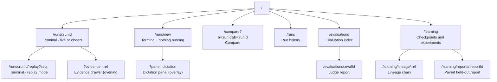
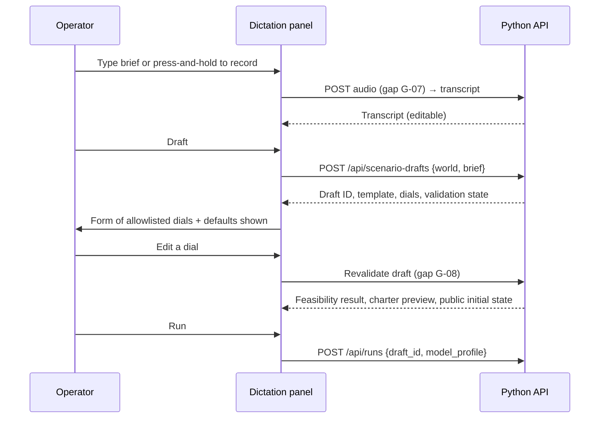
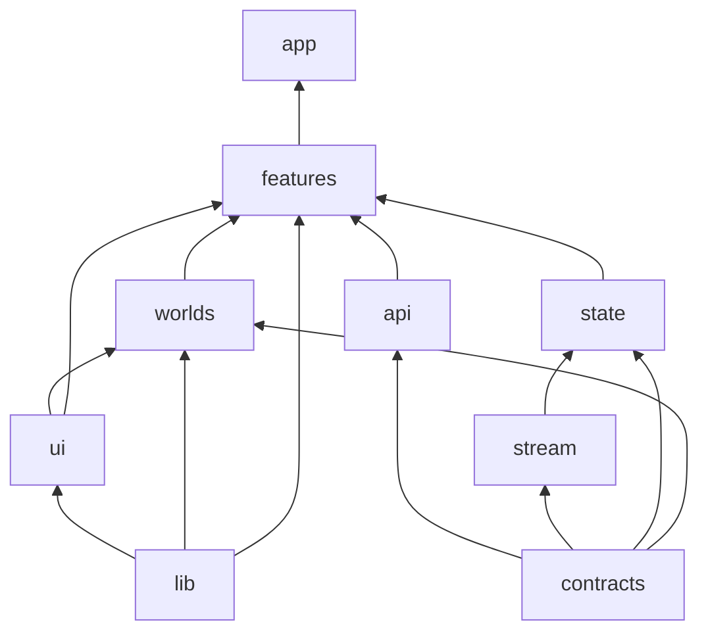
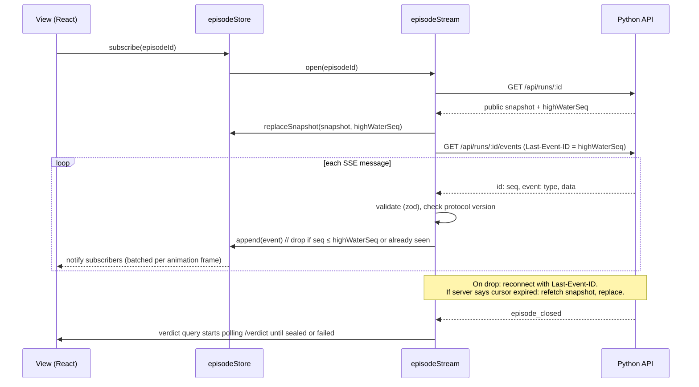

# Renaissance Runbook · Frontend Blueprint

## Design and engineering specification for the `web/` terminal

**Parent document:** [Engineering blueprint](../../docs/BLUEPRINT.md). This document refines the parent's §2 (UI layer), §10 (SSE and failure states), §14 (Terminal and Environment Dictation), and the UI column of §15. Where the two disagree, the parent blueprint wins and this document gets a decision-log entry.

**Scope:** Everything inside `web/`. The frontend is a standalone package with its own toolchain, lockfile, tests, container image, and CI path filter. It talks to the Python API only through the published HTTP and SSE contracts. No Python, simulation, scoring, or provider code lives here, and no frontend code lives outside this folder.

**Status:** Partly implemented against the real API (14 November 2026). [Implementation status](#implementation-status) lists what is built, what was adapted to the API that exists today, and what is waiting on backend work. Everything else below is the target design. Items marked **contract gap** need an agreed backend change before the frontend can rely on them.

## Implementation status

The backend that exists is smaller than this blueprint assumed. `POST /api/runs` streams one run as NDJSON (`opening`, one `decision` per tool call with the server's post-action public snapshot and events, then `complete` or `failed`). There are no run IDs, no SSE, no verdicts, and no model, dictation, learning or evaluation endpoints. The terminal was built on exactly that, with no mock data.

| Area | State | Notes |
|---|---|---|
| Pre-run console (§6) | Built | Before a run, the terminal shows only a session console. Each choice in the controls is echoed as a command line (`model selected: stop-early # Stop-early baseline`, `seed set: 42`, `run --model … --env …`), and each run's ending is logged when its stream closes. The world and the action trace appear only once a run starts. The transcript and choices persist per tab, so a reload keeps them. |
| Terminal shell, top bar, footer controls (§6, §10) | Built | Scenarios and policies are read from the API's OpenAPI document, so they always match the backend's `RunRequest`. The seed is validated against the published bounds. |
| Harbor SVG map, berth calendar, stock, text view (§7) | Built | The API sends no coordinates (G-12), so the client lays out docks deterministically. Known docks are placed like a chart, with north up. |
| Action trace (§8) | Built | Rows are keyed by step number, because the stream has no event `seq`. |
| Results tray (§9) | Adapted | Shows provisional obligations and the API's **planner estimate**, labelled as such. No verifier verdict exists yet (G-06, G-10). |
| Replay (§11) | Built | Every position shows a snapshot the server sent. This is possible because each decision frame carries its post-action observation (G-03 is met for this stream). |
| Evidence drawer (§11) | Built, partly | Before-snapshot facts, action, consequences and rules are shown. Verified alternatives wait on the repair worker. |
| Compare (§11) | Built | Same scenario fingerprint only. The first divergence is computed client-side from the recorded payloads and labelled that way (G-05). |
| Run history | Added | The API keeps no runs, so the browser records them, with export and import. A run streaming when the page closed is marked interrupted, because it cannot be resumed. |
| Environment Dictation (§10) | Blocked | The control is disabled and states the missing APIs (G-07, G-08). |
| Learning and evaluation views (§12, §13) | Blocked | The routes show which endpoints are needed, with no sample data. |
| SSE stream, reconnect with `Last-Event-ID` (§17) | Not applicable yet | The API streams NDJSON per request. `src/stream/ndjson.ts` parses it incrementally; the SSE client waits for durable run IDs. |
| Container image and nginx (§22) | Deferred | The repo has no API container to proxy to yet, and none was built or verified here. |
| Print Guild and Festival renderers | Not started | There is no backend for those worlds. |

Tooling as built, superseding the choices further down: npm with the existing `package-lock.json` (not pnpm), React 19, zod at the wire boundary, plain CSS files with design tokens (not CSS Modules), no TanStack Query (the only REST reads are the OpenAPI catalog and health), `no-restricted-imports` layer rules (not `eslint-plugin-boundaries`), and fixtures recorded from the real API by `scripts/record-fixtures.mjs` (not MSW). The contrast gate is `src/ui/tokens.test.ts`. Playwright drives real Chromium against the real API at desktop and phone sizes, with axe including colour contrast.

## Contents

0. [Implementation status](#implementation-status)
1. [Role of the frontend](#1-role-of-the-frontend)
2. [Design principles](#2-design-principles)
3. [Users, jobs, and the demo path](#3-users-jobs-and-the-demo-path)
4. [Information architecture and routes](#4-information-architecture-and-routes)
5. [Visual language and design tokens](#5-visual-language-and-design-tokens)
6. [The terminal screen](#6-the-terminal-screen)
7. [World renderers](#7-world-renderers)
8. [Action trace pane](#8-action-trace-pane)
9. [Results tray and verdict display](#9-results-tray-and-verdict-display)
10. [Footer controls and Environment Dictation](#10-footer-controls-and-environment-dictation)
11. [Replay, compare, and evidence](#11-replay-compare-and-evidence)
12. [Learning and lineage views](#12-learning-and-lineage-views)
13. [Evaluation and judge views](#13-evaluation-and-judge-views)
14. [System states, errors, and empty states](#14-system-states-errors-and-empty-states)
15. [Accessibility, responsiveness, and motion](#15-accessibility-responsiveness-and-motion)
16. [Frontend architecture](#16-frontend-architecture)
17. [Data flow: snapshots, events, and the episode store](#17-data-flow-snapshots-events-and-the-episode-store)
18. [Contracts and type generation](#18-contracts-and-type-generation)
19. [Component inventory](#19-component-inventory)
20. [Testing strategy](#20-testing-strategy)
21. [Performance budgets](#21-performance-budgets)
22. [Build, configuration, and deployment](#22-build-configuration-and-deployment)
23. [Delivery plan and tickets](#23-delivery-plan-and-tickets)
24. [Risks and fallbacks](#24-risks-and-fallbacks)
25. [Appendix A · Proposed public event taxonomy](#appendix-a--proposed-public-event-taxonomy)
26. [Appendix B · Contract gaps to agree with the backend](#appendix-b--contract-gaps-to-agree-with-the-backend)
27. [Appendix C · UX copy rules](#appendix-c--ux-copy-rules)
28. [Appendix D · Decision log](#appendix-d--decision-log)

---

## 1. Role of the frontend

The parent blueprint sets one rule: **Python owns simulation, tools, evaluation, data, and training. React owns rendering and input.** Every frontend decision below follows from that rule.

| The frontend does | The frontend never does |
|---|---|
| Render public snapshots and public events exactly as the server sent them. | Simulate a round, settle an arrival, or predict a world transition. |
| Show provisional telemetry the server labels as provisional. | Compute, round, or "fix up" the official reward. It shows the sealed verifier verdict. |
| Let an operator pick a model profile, an environment, a draft, and start or stop a run. | Hold provider keys, call NVIDIA, Gemini, or Gemma directly, or transcribe audio itself. |
| Replay a closed episode from stored observations and events. | Mutate an episode during replay, or mix replay state into a live run. |
| Link every displayed fact back to an event sequence number, evidence ID, or digest. | Show a claim (success, gain, gap) without the ID of the record that supports it. |
| Label live, replay, archived, exploratory, and official material at all times. | Let an archived run pass as live, or a playground draft pass as an official suite scenario. |

**Consequence for replay:** the browser cannot rebuild world state by folding events through a reducer, because that reducer is Python. Replay therefore depends on the server keeping a public snapshot per accepted round (parent §10, "Snapshot and event strategy") and exposing it. See [contract gap G-03](#appendix-b--contract-gaps-to-agree-with-the-backend).

## 2. Design principles

These principles settle disputes during the build. When two of them conflict, the earlier one wins.

1. **Evidence before narrative.** Every number on screen can be clicked to reach the record it came from: an event `seq`, an `evidence_id`, a verdict, or an artifact digest. A model's prose sits beside the evidence, never in place of it.
2. **Official versus provisional is unmistakable.** The sealed verdict uses one visual treatment (seal glyph, solid border, verifier version) and nothing else does. Provisional counts use a dashed treatment and the word "Provisional".
3. **State is legible without color.** Every status uses shape, text, and an accessible label as well as color (parent §14). A grayscale screenshot must still tell the story.
4. **One minute to explain a failure.** The judge path from "this run lost" to "here is the notice, the action, the legal alternative, and the consequence" takes three clicks or fewer (parent §1, "A good demo can explain one failed decision in under a minute").
5. **The world is the hero; chrome stays quiet.** The engraved map and the trace carry the visual interest. Panels, menus, and buttons are flat, dark, and restrained.
6. **Same screen, many sources.** Live, replay, archived, and compare views are one layout with different data sources and labels, so operators and judges learn the screen once.
7. **Fail loud, fail labeled.** Connection loss, provider outage, and verifier failure each have a named, visible state. The UI never shows a frozen screen that looks healthy.

## 3. Users, jobs, and the demo path

| User | Primary job | Screens they live in |
|---|---|---|
| Benchmark engineer | Choose a world and model, watch a run, find the decision that broke it. | Terminal, evidence drawer, compare |
| Judge (AfterQuery) | Verify the reward independently and see the frontier-versus-reference gap. | Evaluation report, replay, evidence drawer, verdict panel |
| Demo operator | Drive the ten-minute demo without dead air, with a fallback if a provider fails. | Terminal (projector mode), replay, learning lineage |
| ML engineer | Follow a failure to a lesson, a dataset, an adapter, and a held-out result. | Learning lineage, paired results |
| Scenario author | Turn a typed or spoken brief into a validated exploratory scenario. | Environment Dictation |

### Demo path coverage

The parent's ten-minute demo (§15) maps to screens as follows. Each row must work from a cold page load.

| Time | Demo beat | Screen and state |
|---|---|---|
| 0:00–0:45 | Harbor charter and mission | Terminal, idle, Environments menu open with charter preview |
| 0:45–2:30 | Frontier failure next to reference | Compare view, two archived runs, first divergence pinned, evidence drawer open |
| 2:30–4:00 | Official results and baselines | Evaluation report, paired outcome table |
| 4:00–5:15 | Nemotron dispatch board | Terminal, "Agent's eye" tab showing the delivered board image and the resulting tool action |
| 5:15–6:15 | Gemini verified repair | Evidence drawer, repair candidates with fork outcomes and acceptance rule |
| 6:15–8:10 | Gemma training chain | Learning lineage, then paired base-versus-tuned table |
| 8:10–9:00 | Live attempt | Terminal, live run started from footer |
| 9:00–10:00 | Reproduction and Codex log | Evaluation report, reproduction command and checksums panel |

## 4. Information architecture and routes

### Site map



### Route rules

- The terminal is the home screen. `/` redirects to the most recent active run the operator owns, else `/runs/new`.
- Overlays (evidence drawer, dictation panel, footer menus) are URL state (`?evidence=`, `?panel=`) so a judge can paste a link that opens the exact evidence.
- Replay position is URL state (`?seq=` and optional `&speed=`). Sharing a replay link shares the moment.
- Route modules load lazily. The terminal shell is in the main bundle; learning, evaluation, and compare are separate chunks.
- A top bar breadcrumb mirrors the parent's layout header: `RENAISSANCE RUNBOOK / Harbor Master / Run K59` plus the mode badge.

## 5. Visual language and design tokens

### Concept: "Lamp and Ledger"

A dark harbor-master's office at night. The terminal is the desk: near-black ink, warm parchment text, brass for interaction, and a lamp-lit engraved map as the centerpiece. The Renaissance theme lives in the map engraving, the display serif, and a small set of decorative seals and lamps placed **outside** data fields (parent §14). Data itself is set in a clean monospace so numbers align and read unambiguously.

### Color tokens

Tokens are CSS custom properties defined in `web/src/ui/tokens/tokens.css`. Components reference semantic tokens only, never raw values.

| Token | Dark (default) | Light ("Parchment") | Use |
|---|---|---|---|
| `--bg-canvas` | `#0E0D0B` | `#F4EEDF` | Page background |
| `--bg-panel` | `#16140F` | `#FBF7EC` | Panes and trays |
| `--bg-raised` | `#1F1C16` | `#FFFFFF` | Menus, drawers, dialogs |
| `--border-subtle` | `#2E2A22` | `#DDD3BC` | Pane dividers |
| `--border-strong` | `#4A4334` | `#B9AC8E` | Focused panels, table headers |
| `--text-primary` | `#ECE3CE` | `#1E1A12` | Body text |
| `--text-secondary` | `#B3A88F` | `#5A5140` | Labels, metadata |
| `--text-muted` | `#7D7462` | `#8A7F69` | Disabled, placeholders |
| `--accent-brass` | `#C9A54A` | `#8C6A12` | Primary action, focus ring, selection |
| `--map-ink` | `#C8BB98` | `#3B3222` | Engraved linework on the map |
| `--map-water` | `#141B1F` | `#E3E6DD` | Canal fill |
| `--status-ok` (verdigris) | `#5FA894` | `#2F6E5E` | Accepted, settled, on time |
| `--status-error` (vermilion) | `#D9604A` | `#A3321F` | Rejected, closed route, late |
| `--status-notice` (lapis) | `#6E8FD6` | `#2D4E9A` | Notices, info |
| `--status-pending` (ochre) | `#D6A04A` | `#94631A` | In transit, pending verdict |
| `--status-infra` (violet) | `#A78BD0` | `#5E3F8F` | Infrastructure or provider failure |
| `--seal` | `#B88A2E` | `#7A5410` | The verifier seal, used only for sealed verdicts |

Contrast rule: every text and status token meets WCAG 2.1 AA (4.5:1 for body text, 3:1 for large text and non-text UI) against `--bg-panel` in its theme. A CI script (`web/scripts/check-contrast.ts`) reads the token file and fails the build on a miss.

Status colors always ship with a glyph and a word:

| Status | Glyph | Word |
|---|---|---|
| Live | `●` | LIVE |
| Replay | `↺` | REPLAY |
| Archived | `▣` | ARCHIVED |
| Accepted | `✓` | Accepted |
| Rejected | `✕` | Rejected · `code` |
| Notice | `◆` | Notice |
| In transit | `◐` | In transit · ETA r4 |
| Pending verdict | `◌` | Verdict pending |
| Sealed verdict | seal icon | Sealed · `harbor-verifier-v1` |
| Infrastructure failure | `⚠` | Verifier failed / Provider unavailable |

### Typography

Three families, all self-hosted under `web/public/fonts/` so offline judge replay needs no network.

| Role | Family | Use | Sizes |
|---|---|---|---|
| Display | EB Garamond (600) | Product name, world titles, empty-state headings | 20, 28, 36 |
| Interface | IBM Plex Sans (400/500/600) | Labels, buttons, menus, prose | 12, 13, 14, 16 |
| Data | IBM Plex Mono (400/500) | IDs, rounds, quantities, payloads, hashes, trace rows | 12, 13, 14 |

Numbers use tabular figures (`font-variant-numeric: tabular-nums`). Hashes truncate in the middle (`sha256:3f9a…c21e`) with a copy button and the full value in the accessible name.

### Spacing, radius, elevation

- Spacing scale on a 4 px base: `--space-1` 4, `--space-2` 8, `--space-3` 12, `--space-4` 16, `--space-6` 24, `--space-8` 32.
- Radius: `--radius-sm` 2 px for chips, `--radius-md` 4 px for panels. The terminal stays square-edged; no pill buttons.
- Elevation is border plus background step, not shadow. Overlays add one soft shadow (`0 8px 24px rgb(0 0 0 / 0.4)`).

### Motion tokens

| Token | Value | Use |
|---|---|---|
| `--motion-fast` | 120 ms | Hover, focus, menu open |
| `--motion-base` | 200 ms | Panel and drawer transitions |
| `--motion-voyage` | 600 ms per round, eased | Vessel movement between accepted events |
| `--ease-standard` | `cubic-bezier(0.2, 0, 0, 1)` | Default |

Under `prefers-reduced-motion: reduce`, all durations become 0 and vessels jump to their new positions. Movement is never the only cue: the trace row and the ETA label carry the same information.

### Iconography and decoration

- Interface icons: one outline set at 16 and 20 px (Lucide, tree-shaken), 1.5 px stroke.
- Domain glyphs drawn in-house as SVG: dock seal, barge hull (shallow and deep draft variants), canal lock, press, drying rack, cart, venue banner.
- Decorative assets (compass rose, lamps, harbor seals, cartouche frame for the world title) are `aria-hidden`, sit in margins, and never overlap a data label.

### Themes and modes

- **Dark** is the default terminal theme.
- **Parchment** (light) is for printed judge reports, bright rooms, and screenshots in the submission.
- **Projector mode** (`?display=projector` or a toggle) scales type by 1.25, thickens map lines, and hides secondary metadata for the live demo.
- Theme follows `prefers-color-scheme` unless the operator picks one; the choice persists in `localStorage` as a per-viewer convenience only.

## 6. The terminal screen

### Desktop layout (≥ 1280 px)

```text
┌──────────────────────────────────────────────────────────────────────────────────┐
│ ⚓ RENAISSANCE RUNBOOK / Harbor Master / Run K59    ● LIVE  Round 2 / 6  rev 3    │  top bar
├────────────────────────────────────────────────────┬─────────────────────────────┤
│ WORLD                         [Map] [Agent's eye]  │ ACTION TRACE      [filter ▾]│
│                                                    │ ── Round 2 ──────────────── │
│      west ◉━━━━━ short canal ━━━━✕━━━━◉ east       │ 27 ◆ Notice n4 · short      │
│        ┃╲        closed r2            ╱            │      canal closed           │
│        ┃ ╲━━━━━━ outer canal ━━━━━━━━╱             │ 28 ⌕ inspect berths         │
│        ┃         2 rounds · ≤ d1                   │ 29 ✓ commit · 2 ops         │
│        ◉ north                                     │      A → outer · cloth 4    │
│                                                    │      ETA r4                 │
│  Vessels  A ◐ outer → east ETA r4   B ⚓ north      │ ── Round 3 ──────────────── │
│  Berths   east r4 ■ A   r5 □   north r5 □          │ 30 ⏵ wait                   │
├────────────────────────────────────────────────────┴─────────────────────────────┤
│ RESULTS   cloth→east 0/4 ◐ in transit, due r4  │ grain→north 3/3 ✓ r1          │
│           Spend 9 / 20  ·  Reads 22  ·  Attempts 10  ·  Reward ◌ pending verdict │
│           [ Compare ] [ Replay ] [ Evidence ]                                    │
├──────────────────────────────────────────────────────────────────────────────────┤
│ [ Models: nemotron-3.5-super-vl ▾ ] [ Environments: Harbor · closure ▾ ]         │
│ [ Environment Dictation ▾ ]                                   [ ■ Stop run ]     │
└──────────────────────────────────────────────────────────────────────────────────┘
```

### Grid definition

```css
.terminal {
  display: grid;
  grid-template-columns: minmax(0, 1fr) clamp(320px, 28vw, 440px);
  grid-template-rows: auto minmax(0, 1fr) auto auto;
  grid-template-areas:
    "topbar  topbar"
    "world   trace"
    "results results"
    "footer  footer";
  height: 100dvh;
}
```

- The world and trace panes scroll independently; the top bar, results tray, and footer never scroll away.
- The results tray is collapsible to one summary line (`R` key) to give the map more room.
- The trace pane can be resized by dragging its left edge; width persists per viewer.

### Top bar

Left to right: product mark, breadcrumb (world, run ID), mode badge (LIVE, REPLAY, ARCHIVED, EXPLORATORY), round counter `Round r / H`, world revision, connection indicator, and a clock showing the provider turn timer while a model is thinking (`Model turn 0:07`). The mode badge is persistent and never scrolls (parent §14, "Demo views have a persistent live or replay label").

### Cross-pane linking

Selection is shared state. Hovering or focusing an entity anywhere highlights it everywhere:

- Hover trace row 29 → barge A, the outer canal, and berth east/r4 glow on the map, and the cloth obligation highlights in the results tray.
- Click barge A on the map → the trace filters to rows that mention `barge-a`.
- Click a notice glyph on a closed canal → the trace scrolls to the notice row and the evidence drawer offers the notice record.

Entity IDs from the public projection (`barge-a`, `short-canal`, `east`, `cloth-east`) are the join key. The frontend never invents IDs.

## 7. World renderers

### Renderer contract

Each world gets one renderer behind a single interface, so the terminal shell stays world-agnostic (parent §2, "One world renderer per domain").

```ts
// web/src/worlds/types.ts
export interface WorldRendererProps<TView> {
  view: TView;                         // public projection for the selected round, already validated
  pending: PendingMovement[];          // in-flight work with ETA, from the projection
  selection: EntitySelection;          // shared highlight state
  onSelect(entity: EntityRef): void;
  mode: "live" | "replay" | "preview"; // preview = dictation draft, no episode yet
  motion: "full" | "reduced";
}

export interface WorldModule<TView> {
  id: "harbor" | "print_guild" | "quartermaster";
  title: string;
  parseView(raw: unknown): TView;      // runtime-validated against the world's public schema
  Renderer: React.ComponentType<WorldRendererProps<TView>>;
  Legend: React.ComponentType;
  describe(view: TView): string;       // plain-text summary for screen readers and the Agent's eye diff
}
```

Worlds register in `web/src/worlds/registry.ts`. An unfinished world registers with `status: "unavailable"` and a reason, so the Environments menu can show it disabled with that reason (parent §14).

### Harbor Master

**Technology:** SVG in the DOM. The first release has three or four docks and up to about eight edges (parent §4), so SVG gives crisp scaling, native focus, hit targets, and accessible names at no performance cost. Canvas is reserved for a future map large enough to need it.

**Layout source:** dock coordinates and edge curves come from the server's render data (`worlds/harbor/render_data.py` in the parent's repository layout). The frontend does not lay out the graph. If coordinates are missing, a deterministic fallback places docks on a circle in ID order and shows a "fallback layout" note.

**Map elements:**

| Element | Encoding |
|---|---|
| Dock | Engraved seal with label. Berth capacity shown as a small calendar strip under the label: one square per listed round, filled when allocated, outlined when held, crossed when unavailable. |
| Route edge (open) | Solid engraved line with arrowhead for direction. Label: name, duration in rounds, cost, draft ceiling `≤ d1`. |
| Route edge (closed) | Dashed line in `--status-error`, a `✕` lock glyph at the midpoint, and label `closed r2`. |
| Route edge (restricted by notice) | Solid line with a `◆` notice glyph linking to the notice record. |
| Vessel at dock | Hull glyph with its letter, draft class shown by hull depth, capacity in the tooltip and accessible name. |
| Vessel in transit | Hull glyph placed along the path at `(current_round − depart) / (arrive − depart)`, ETA label `ETA r4`, cargo chip `cloth 4`. Interpolates between accepted events only. |
| Cargo lot | Stack chip at the source dock: `cloth 4 · loadable r2` before release, `cloth 4` after. |
| Receipt | Brief verdigris pulse at the destination dock and a receipt chip `✓ cloth 4 @ r4`. |
| Late receipt | Vermilion chip `late · cloth 4 @ r5 (due r4)`. Physical delivery shows; credit does not. |

**Berth calendar panel:** below the map, a compact table of docks by round showing held, allocated, free, and unavailable slots. It is the single fastest way to explain "Arrival overcommit" and "Last berth" failures (parent §4 and §7).

**Agent's eye tab:** shows exactly what the model received for the selected observation: the JSON projection or the canonical board PNG that Pillow rendered server-side, with its hash and `facts_equivalence_version`. This supports the Nemotron board-versus-text comparison and lets a judge check that the model saw the decisive fact. The frontend never re-renders the model's board; it fetches the stored artifact by hash.

### Print Guild (R4, off the critical path)

**Primary view:** resource Gantt chart. Rows are typesetter, proofreader, presses (with format support), and drying racks. Columns are rounds. Bars are batches with half-open `[start, end)` intervals, colored by commission, hatched when obsolete after a revision. Downtime appears as a hatched band with a notice glyph.

**Secondary view:** commission cards showing active revision, stage tokens (typeset, proof, print, dry), due round, and credited copies.

### Festival Quartermaster (R4, off the critical path)

**Primary view:** allocation board. Left column: stock lots by grade and location. Right column: venues with demand lines and accepted substitutions. Lines between them show transfers in flight with cart and ETA. The reserve floor appears as a ruled line on the central warehouse stock bar, so an attempted violation is visible as a crossing.

**Secondary view:** wallet and supplier quotes with revision history.

## 8. Action trace pane

### Purpose

The trace is the observable decision record (parent §14): notices, observations, inspects, tool attempts, payloads, rejections, receipts, and lifecycle changes. It is grouped by round, and every row carries its event `seq`.

### Row anatomy

```text
29  ✓ commit · 2 operations                        r2 · rev 2→3
    reserve_berth  barge-a → east @ r4
    dispatch       barge-a via outer-canal · cloth-east × 4 · ETA r4
    action_id round-2-dispatch-cloth                [Payload] [Evidence]
```

- Column 1: `seq`, monospace, right-aligned.
- Column 2: status glyph and tool name.
- Column 3: round and revision transition, right-aligned.
- Body: human-readable operations, generated from the typed payload by a pure formatter per world. The raw JSON is one click away.

### Row types

| Row | Visual | Body |
|---|---|---|
| Notice | `◆` lapis, full-width rule | Notice type, target, effective round, public change description |
| Observation delivered | `◇` muted | "Observation delivered" with view type and hash; expandable |
| Inspect | `⌕` muted | Kind, ref, view; result summary |
| Commit accepted | `✓` verdigris | Operations, ETA, cost delta |
| Commit rejected | `✕` vermilion | Error code, public detail, "attempts remaining: n", link to the notice if the rejection cites one |
| Wait | `⏵` muted | "Wait · advanced to r+1" |
| Receipt settled | `■` verdigris | Job, units, dock, round, on-time or late |
| Finish | `⏹` | Terminal reason |
| Lifecycle | `│` muted | Created, stopped by operator, timed out, budget exhausted |
| Model note | quote bar, italic | Model-authored note, labeled "Model note · no scoring authority" (parent §11) |
| Analyst addition | brass bar | Post-run Gemini analysis, labeled "Analyst · Gemini · post-run", with cited evidence IDs (parent §14) |

Provider-internal reasoning is never shown (parent §14).

### Behavior

- **Auto-follow** keeps the newest row in view during a live run. Scrolling up pauses follow and shows a "Jump to latest (n new)" pill.
- **Filters:** by type (mutations only, rejections only, notices only), by entity, and by round. Filter state is in the URL.
- **"Why did this fail?"** appears on rejected rows and on rows flagged by a failure detector. It opens the evidence drawer with the preceding observation, the action, the rule from the charter, and any linked notice.
- **Virtualization** starts at 300 rows. A six-round Harbor run is small, but replays of long evaluation runs must stay smooth.
- The trace has `role="log"` with `aria-live="polite"` during live runs, announcing only notices, rejections, receipts, and closure so a screen reader is not flooded by reads.

## 9. Results tray and verdict display

### Layout

```text
RESULTS                                                         [▾ collapse]
Obligations
  cloth → east     ▕████░░░░▏ 0 / 4 credited · 4 in transit · due r4   ◐
  grain → north    ▕████████▏ 3 / 3 credited · settled r1               ✓
Telemetry (provisional)
  Spend 9 / 20 cap   Slack —   Reads left 22 / 24   Attempts left 10 / 12
Verdict
  ◌ Pending · waiting for episode close
```

After closure and verification:

```text
Verdict  [seal] Sealed · harbor-verifier-v1 · state sha256:3f9a…c21e
  Complete ✓   P = 1   Q = 351/700 ≈ 0.501429   R = 5953/7000 ≈ 0.850429
  Q = 0.6 × cost 11/20 + 0.4 × slack 3/7
  Critical checks  conservation ✓  valid receipts ✓  consistent replay ✓
  Terminal reason  finished at r4   Evidence: terminal seq 34, receipts 19, 31
```

### Rules

- **Two zones, never mixed.** "Telemetry (provisional)" comes from the live projection. "Verdict" comes only from `GET /api/runs/:id/verdict`. The provisional zone uses a dashed border; the verdict zone uses a solid border and the seal. Only the verdict zone may say "Reward".
- **The frontend does not calculate R.** It renders the verifier's fields. If the verifier returns exact fractions (recommended, [gap G-06](#appendix-b--contract-gaps-to-agree-with-the-backend)), the UI shows the fraction and a decimal with the one display rounding rule (6 decimal places, round half to even). The unrounded value is in the tooltip and accessible name.
- **Partial runs show the branch they hit.** For an incomplete run the formula line reads `R = 0.15 × P = 0.15 × 1/2 = 0.075`, so the gap between "busy" and "complete" is visible (parent §4 worked example).
- **Infrastructure failure is not zero.** A verifier failure shows `⚠ Verifier failed · reason · artifact ID` and no reward (parent §8, "Do not impute an ordinary zero when no valid verdict exists").
- **Tuned runs show lineage.** For Gemma adapter runs, the tray shows dataset digest, adapter digest, and whether retrieval was enabled, each linking to the learning view (parent §14).
- **Action buttons:** Compare (prefills the compare picker with this run), Replay (enters replay at `seq` of the first notice), Evidence (opens the drawer at the most consequential flagged decision if one exists, else the terminal event).

## 10. Footer controls and Environment Dictation

### Footer

The footer is the operator's control strip. Every control is a real `<button>` with a menu, reachable by Tab, and has a shortcut.

| Control | Shortcut | Contents | Rules |
|---|---|---|---|
| Models ▾ | `M` | Grouped list: Reference policy, Frontier (NVIDIA, organizer providers), Gemma base, Gemma adapters by digest. Each row shows the actual model ID, modality (text or board), memory on or off, repair assistant on or off. | Unavailable profiles stay visible, disabled, with the server's specific reason (parent §14). Selecting does not touch a running episode. |
| Environments ▾ | `E` | Worlds, then scenario families, then a charter preview with the public initial state rendered in preview mode. Badges: Official suite, Dev, Exploratory, Unfinished. | Selection is staged for the next run only. |
| Environment Dictation ▾ | `D` | Opens the dictation panel. | See below. |
| Run / Stop | `Ctrl+Enter` / `Ctrl+.` | Run is the primary brass button. During a live run it becomes Stop. | Run is disabled with a reason until model and scenario are both valid. Stop asks for confirmation in the judge profile: "Stopping records terminal reason `operator_stop` and scores the work settled so far." |

### Environment Dictation flow

Dictation turns a brief into a validated scenario (parent §14, "Dictation contract"). The model drafts; deterministic rules decide.



**Panel layout (drawer from the footer, 480 px wide on desktop, full screen on mobile):**

1. **Brief.** Textarea plus a press-and-hold record button. Recording shows a level meter and elapsed time; release uploads. The browser uses `MediaRecorder` and sends audio to the API; it holds no transcription key.
2. **Transcript.** Editable text, labeled as the source brief. It is kept as display metadata only.
3. **Structured draft.** A form generated from the world's dial schema in the environment registry: bounded integers as steppers with min and max shown, enums as segmented controls. Defaults are visible, not hidden. Fields the model proposed are marked "drafted"; fields the operator changed are marked "edited".
4. **Validation.** Server results in plain language with the rule that failed, for example "No route reaches East by round 4." Each message anchors to the dial that caused it.
5. **Preview.** The world renderer in `preview` mode showing the public initial state, plus the charter text. Future notices are not shown because they are hidden simulator state.
6. **Run.** Enabled only when the draft is feasible. The run launches with the badge EXPLORATORY and a note that drafts stay outside official suites and training splits by default (parent §14).

## 11. Replay, compare, and evidence

### Replay

Replay uses the terminal layout with a scrubber above the results tray and the REPLAY badge in the top bar.

```text
↺ REPLAY  Run K59 (closed · finished)            ⏮ ◀ ⏯ ▶ ⏭    1×  2×  4×
 r0        r1        r2  ◆      r3        r4  ■■     r5      r6
 ├─────────┼─────────┼──●───────┼─────────┼──────────┼───────┤  seq 29 / 34
```

- Ticks mark rounds; glyphs mark notices, rejections, receipts. Clicking a glyph jumps to it.
- Keyboard: `Space` play or pause, `J`/`K` step one event, `[`/`]` previous or next round, `Home`/`End`.
- At cursor `seq = s`, the world pane shows the public snapshot for the latest accepted round at or before `s`, and the trace shows events up to `s`. In-flight vessels are placed from the snapshot's movement records, not computed.
- Replay is read-only. All mutation controls are disabled with the reason "Replay is read-only. Start a new run to act."
- Replaying a live run is allowed: the operator can scrub back while the stream keeps appending. A "Return to live" button sits next to the badge.

### Compare

Two runs on the same scenario, aligned by simulation round (parent §14).

```text
┌─────────── A · Reference policy ───────────┬─────────── B · Frontier #2 ───────────┐
│ map at r2                                   │ map at r2                             │
├─────────────────────────────────────────────┴───────────────────────────────────────┤
│ r0  ✓ commit B → north · grain 3  │ r0  ✓ commit A → north · grain 3   ◀ first divergence│
│ r1  wait                          │ r1  wait                                          │
│ r2  ✓ commit A → outer · cloth 4  │ r2  ✕ commit B via outer · draft 2 > ≤ d1           │
├─────────────────────────────────────────────┬───────────────────────────────────────┤
│ Sealed R = 0.850429  complete               │ Sealed R = 0.075  partial (P = 1/2)    │
└─────────────────────────────────────────────┴───────────────────────────────────────┘
```

- Rows align by round, not by `seq`, so reads and retries do not shift the comparison.
- The **first divergence** is the first round where the accepted operation sets differ. It is pinned, and the "Explain divergence" action opens the evidence drawer for both sides. Divergence is computed by the server ([gap G-05](#appendix-b--contract-gaps-to-agree-with-the-backend)); as a fallback the UI compares the server-supplied canonical payload hashes per round and labels the result "client-side comparison".
- Compare refuses runs from different scenario identity hashes, with that reason. A variant comparison (for example, closure versus no-closure control) is a separate, labeled "matched control" mode.
- Map panes share one replay cursor.

### Evidence drawer

A right-side drawer (640 px on desktop, full screen on mobile) opened by `?evidence=<ref>`. It answers "what did the agent know, what did it do, what did the rules say, and what happened."

| Section | Content |
|---|---|
| Observation | The exact observation delivered before the action: JSON tree or board image, with hash and revision. Facts the action depended on are highlighted. |
| Action | Tool, typed payload, action ID, result (accepted or error code). |
| Rule | The charter clause that applied, quoted from the public charter. |
| Notices | Every notice in effect at that round, with effective round and description. |
| Consequence | What followed: receipts, rejections, or "no feasible continuation" from the failure detector, with its confidence label. |
| Alternatives | Verified repairs: candidate operations, fork outcomes per suffix, delta, acceptance rule, and source (rules baseline or Gemini). Gemini candidates are labeled and show their cited evidence IDs and whether the citations were valid. |
| Provenance | Episode ID, scenario hash, verifier version, event range, copy-link button. |

## 12. Learning and lineage views

### Checkpoints index (`/learning`)

A table of checkpoints: alias (if promoted), adapter digest, base model revision, dataset digest, training job status, dev metrics, held-out report link. Candidate, promoted, and failed checkpoints are all listed; failed jobs show their failure reason (parent §13, "Failure handling").

### Lineage chain (`/learning/lineage/:ref`)

The parent's data lineage (§12) drawn as a horizontal chain. Each node is a card with its ID or digest, status, and a link to the record. The `:ref` can be any node; the view resolves the chain both ways.

```text
[Episode K59] → [Failure point seq 29 · wrong priority] → [Fork comparison · Δ +0.775]
     → [Lesson L-112 · train] → [Dataset ds:9c1e…] → [Training job tj-04]
     → [Adapter ad:51b0…] → [Held-out report hr-02]
```

- Nodes are colored by stage status, with glyphs: verified, pending, rejected (with the export gate's rejection reason such as `split_overlap`, parent Appendix E).
- Clicking the failure point opens the evidence drawer for that decision.
- The chain is the demo's "Gemma training chain" beat, so it must render in projector mode without horizontal scroll at 1280 px.

### Paired held-out report (`/learning/reports/:id`)

- A summary strip: complete episodes base versus tuned, mean paired delta, and the four discordance counts (base-only success, tuned-only, both, neither) from parent §13.
- A per-scenario table with base reward, tuned reward, completion for each, delta, and "first differential decision" linking to a compare view.
- A dot plot of per-scenario deltas with zero marked. Negative and zero gains are shown at the same visual weight as positive ones (parent §15, "Show measured result even if it is negative").
- The 2×2 retrieval comparison (base, tuned, base with memory, tuned with memory) when that experiment exists.
- Charts follow one rule: raw points are always visible; aggregates never appear without the points behind them.

## 13. Evaluation and judge views

### Evaluation index (`/evaluations`)

Each evaluation shows its suite hash, model profiles, stage (dev, frozen, official), attempt counts, and infrastructure failures counted separately.

### Judge report (`/evaluations/:evalId`)

The screen judges use to check the 30/30/25/15 criteria (parent §1). It renders the paired outcome report from parent Appendix C.

| Section | Content |
|---|---|
| Header | Evaluation ID, suite manifest hash, verifier version, frozen date, disclosure link |
| Outcome table | Scenario × arm: Reference, Frontier #1–#3, Idle, Early stop. Each cell shows sealed R and a completion glyph and links to the run. Infrastructure failures show `⚠` with a reason, not a number. |
| Gap summary | Reference minus frontier per scenario, as raw values. No aggregate without denominators. |
| Failure analysis | One card per explained failure: notice, action, legal alternative, consequence, linking to the evidence drawer. |
| Reward integrity | The five-case quick suite from parent §15 (no-op, early stop, duplicate retry, alternate valid completion, late delivery) with verdicts. |
| Reproduction | The exact command (`make judge`, `make verify-replay BUNDLE=…`), lockfile hashes, and `checksums.txt` contents, each with a copy button. |
| Bundle | Download link for the judge bundle; replay works offline from it. |

The judge report has a print stylesheet that switches to the Parchment theme, expands all tables, and adds IDs as text next to links.

## 14. System states, errors, and empty states

The parent requires explicit waiting, working, closed, verifier failed, and provider unavailable states (§10). The full state model:

### Connection states (stream)

| State | Indicator | Behavior |
|---|---|---|
| Connecting | `◌ Connecting` | Skeleton panes; no stale data shown as current. |
| Live | `● Live` | Normal. |
| Reconnecting | `◐ Reconnecting (attempt n)` in ochre | Resubscribe with `Last-Event-ID`. Panes stay visible with a thin ochre bar: "Showing state as of seq 29." Exponential backoff with jitter, 0.5 s to 15 s. |
| Resynced | Toast "Resynced from snapshot" | Cursor fell outside retention; the client fetched a fresh snapshot and replaced state. |
| Offline | `⚠ Offline` in violet | Browser offline. Mutation controls disabled with that reason. |
| Protocol mismatch | Blocking banner | Server's event protocol major version differs from the client's. "This terminal is out of date for this server. Reload." No attempt to render unknown structures. |

### Episode states

| State | Display |
|---|---|
| Waiting | "Waiting for the model's first action" with the provider turn timer |
| Working | Turn timer running, last observation highlighted in the trace |
| Closed | Terminal reason chip: finished, horizon, budget exhausted, operator stop, timeout |
| Verifier pending | `◌ Verdict pending` with elapsed time |
| Verifier failed | `⚠ Verifier failed` with reason and artifact ID; no reward shown |
| Provider unavailable | Violet banner with the provider's error class. Offers "Open labeled archived run" (parent §10). The archived run opens with the ARCHIVED badge, never LIVE. |

### Empty states

| Where | Message | Action |
|---|---|---|
| `/runs/new` | "No run in progress. Pick a model and an environment, then press Run." | Opens Models menu |
| Trace before first event | "Nothing yet. The model has the opening observation." | None |
| Learning index with no checkpoints | "No adapters trained yet. The first checkpoint appears after a training job publishes." | Link to the lineage docs |
| Evaluation with no attempts | "This evaluation is frozen but has no attempts yet." | None |

### Error presentation

- Typed API errors map to plain-language messages with the code shown in monospace (`stale_revision`). The mapping lives in one file, `web/src/api/errors.ts`, keyed by the error codes in parent §3.
- Unknown errors show a generic message plus a correlation ID from the response header so logs can be found.
- Route-level error boundaries keep the top bar and footer alive when one pane crashes.

## 15. Accessibility, responsiveness, and motion

### Accessibility (target: WCAG 2.1 AA)

- **Keyboard:** every action reachable by keyboard; visible brass focus ring (2 px, 2 px offset); skip links to World, Trace, Results, and Controls; a shortcut sheet on `?`.
- **Map:** the SVG has `role="group"` with a title. Docks, edges, and vessels are focusable with accessible names such as "Barge A, shallow draft, capacity 4, in transit on outer canal to East, ETA round 4, carrying cloth 4." Arrow keys move between connected docks. A "Describe map" button reads `WorldModule.describe(view)`.
- **Tables over charts:** every chart has a "View as table" toggle.
- **Live regions:** only notices, rejections, receipts, closure, and verdicts are announced.
- **Color independence:** checked with a grayscale screenshot test in Playwright.
- **Automated checks:** axe on every route and on each fixture state in CI; failures block merge.

### Breakpoints

| Width | Layout |
|---|---|
| ≥ 1280 px | Full three-zone grid, trace on the right. |
| 960–1279 px | Trace narrows to 320 px; map labels drop cost, keeping duration and draft. |
| 600–959 px | Single column: world, then trace, then results. Footer pinned. Trace starts collapsed to the latest round. |
| < 600 px | Single column with a tab bar (World, Trace, Results). Footer controls collapse into one "Controls" sheet; Run and Stop stay visible. 16 px side gutters; no horizontal page scroll. |

On narrow screens the trace follows the world and the footer stays reachable by keyboard (parent §14).

### Motion

- Vessel motion interpolates only between two accepted states the server sent; it never predicts.
- Receipts pulse once (300 ms). Notices draw the closure stroke once (400 ms).
- Reduced motion: no interpolation, no pulses; state changes are instant.
- Replay at 4× shortens voyage duration proportionally with a 150 ms floor.

## 16. Frontend architecture

### Folder boundary

```text
AfterQuery/
  src/runbook/          # Python: engine, API, workers (not touched by frontend work)
  migrations/
  harness/
  tests/
  docs/BLUEPRINT.md
  web/                  # ← everything in this document lives here
```

Frontend changes stay inside `web/`. Three integration points sit outside it and are owned by the backend or repository maintainers, each a one-time hook, listed in [§22](#22-build-configuration-and-deployment).

### `web/` layout

```text
web/
  README.md
  package.json
  pnpm-lock.yaml
  tsconfig.json
  vite.config.ts
  eslint.config.js
  playwright.config.ts
  .env.example                 # VITE_ names only, no secrets
  Dockerfile                   # multi-stage build → static nginx image
  nginx.conf                   # SPA fallback, /api proxy, SSE buffering off
  index.html
  docs/
    FRONTEND_BLUEPRINT.md      # this document
    adr/                       # frontend decision records
  public/
    fonts/                     # self-hosted EB Garamond, IBM Plex Sans and Mono
    decor/                     # aria-hidden seals, lamps, compass, cartouche
  scripts/
    sync-contracts.ts          # pulls OpenAPI + event schemas, generates types
    check-contrast.ts          # token contrast gate
  src/
    app/                       # composition root only
      main.tsx
      App.tsx
      router.tsx
      providers.tsx            # query client, theme, selection, shortcuts
      ErrorBoundary.tsx
    contracts/                 # shapes of what crosses the wire
      generated/               # produced by sync-contracts; never hand-edited
        openapi.ts
        events.schema.json
      events.ts                # runtime schema (zod) for public events + version guard
      views/                   # runtime schemas per world's public projection
        harbor.ts
      ids.ts                   # branded ID types: EpisodeId, Seq, EvidenceId, Digest
    api/                       # HTTP transport, no React
      http.ts                  # fetch wrapper, same-origin credentials, error normalization
      errors.ts                # error code → message map
      endpoints/
        models.ts
        environments.ts
        drafts.ts
        runs.ts
        verdicts.ts
        learning.ts
        evaluations.ts
      queryKeys.ts
    stream/                    # SSE transport, no React
      sseClient.ts             # EventSource wrapper, heartbeat watchdog, backoff
      episodeStream.ts         # snapshot-then-cursor orchestration, resync
    state/                     # client state, framework-light
      episodeStore.ts          # external store: snapshot, events by seq, cursor
      replayCursor.ts
      selection.ts             # cross-pane entity highlight
      selectors/               # pure derivations: rounds, obligations, pending
    worlds/                    # one module per world, behind WorldModule
      types.ts
      registry.ts
      harbor/
        HarborMap.tsx
        BerthCalendar.tsx
        VesselGlyph.tsx
        Legend.tsx
        format.ts              # operation → readable trace text
        describe.ts
        index.ts
      print_guild/
      quartermaster/
    features/                  # screens and panes; each exports a public index.ts
      terminal/
      world-pane/
      trace/
      results/
      footer/
      dictation/
      replay/
      compare/
      evidence/
      learning/
      evaluation/
      runs-history/
    ui/                        # design system, no domain knowledge
      tokens/
        tokens.css
        themes.css
      components/
      icons/
      layout/
    lib/                       # small pure helpers
      format/                  # rounds, fractions, hashes, durations
      keyboard.ts
      a11y.ts
    test/
      fixtures/                # golden public payloads (see §20)
      msw/                     # mock HTTP handlers
      sse/                     # scripted event streams
      render.tsx
    dev/
      FixtureGallery.tsx       # dev-only route rendering every fixture state
  e2e/
    smoke.spec.ts
    replay.spec.ts
    a11y.spec.ts
```

### Layer rules

Dependencies point one way. ESLint (`eslint-plugin-boundaries`) enforces them; a violation fails CI.



Read the arrows as "is imported by".

| Layer | May import | Must not import |
|---|---|---|
| `contracts` | `zod` only | Anything else in `src` |
| `lib` | Nothing in `src` | React components, API |
| `ui` | `lib`, React | `contracts`, `api`, `state`, `worlds`, `features` |
| `api`, `stream` | `contracts`, `lib` | React, `state`, `features` |
| `state` | `contracts`, `stream`, `lib` | `api` endpoints, React components |
| `worlds` | `contracts`, `ui`, `lib` | `api`, `stream`, `features` |
| `features` | Everything below, other features only through their `index.ts` | Another feature's internal files |
| `app` | Everything | Nothing imports `app` |

### Technology choices

| Concern | Choice | Reason |
|---|---|---|
| Build | Vite, TypeScript strict | Parent §2 choice. Fast dev server with an `/api` proxy. |
| UI library | React 18 | Parent §2 choice. |
| Routing | React Router (data router) | URL-driven overlays and replay position; lazy route modules. |
| Server data (REST) | TanStack Query | Caching, retries, and stale-time per endpoint; verdict polling until sealed. |
| Live episode data | Custom external store + `useSyncExternalStore` | SSE events need ordered, deduplicated, append-only handling that a request cache does not model well. |
| Runtime validation | zod at the wire boundary | Unknown additive fields ignored, incompatible versions rejected (parent §14). |
| Styling | CSS Modules + CSS custom property tokens + CSS grid | Parent §2 names CSS grid; no runtime styling cost; tokens shared with SVG. |
| Map | SVG in React | Small graphs, accessible, crisp. |
| Charts | Hand-built SVG for the few charts needed (dot plot, bars, Gantt) | Small surface; full control over accessibility and raw-point display. |
| Icons | Lucide (tree-shaken) + in-house domain SVGs | |
| Unit and component tests | Vitest + Testing Library + `vitest-axe` | |
| Mock server | MSW for HTTP; a scripted SSE emitter for streams | |
| End-to-end | Playwright | Parent §15 asks for one browser smoke flow; this extends it. |
| Package manager | pnpm with a committed lockfile | Locked installs in CI and judge bootstrap (parent §2). |

## 17. Data flow: snapshots, events, and the episode store

### Live run



### Store shape

```ts
interface EpisodeState {
  episodeId: EpisodeId;
  protocolVersion: string;
  snapshot: PublicSnapshot;            // latest authoritative public state
  snapshotSeq: Seq;                    // seq the snapshot is current as of
  events: Map<Seq, PublicEvent>;       // deduplicated by seq
  orderedSeqs: Seq[];                  // sorted, tolerates gaps (parent §10)
  roundSnapshots: Map<number, PublicSnapshot>; // per-round public state for replay
  lifecycle: "active" | "closed";
  connection: ConnectionState;
}
```

### Rules

1. **Snapshot first, then events after its sequence.** This is the parent's reconnect protocol (§10) and the only way state is built.
2. **Deduplicate by `(episode_id, seq)`.** Duplicate deliveries are dropped silently; the store is idempotent.
3. **Gaps are normal.** The public projection may omit private records (parent §10), so missing sequence numbers are not errors.
4. **The snapshot is the truth for world state.** Events drive the trace and animations. When an event carries a post-decision public observation (parent §3, round semantics step 6), the store replaces `snapshot` with it and records it in `roundSnapshots`. The UI never applies domain logic to derive the next state.
5. **Batch renders.** Events arriving within one animation frame cause one render.
6. **Unknown event types render as a neutral "Unrecognized event" row** with raw JSON, unless the protocol major version differs, which blocks (see §14).
7. **Stores are per episode** and released when no view subscribes, so compare views hold two independent stores.

### REST data (TanStack Query)

| Query | Key | Stale time | Notes |
|---|---|---|---|
| Models | `["models"]` | 30 s | Availability can change during the event. |
| Environments | `["environments"]` | 5 min | Versioned registry. |
| Draft | `["draft", id]` | 0 | Revalidated on every dial change (debounced 300 ms). |
| Run summary | `["run", id]` | 0 | Used only for the initial snapshot. |
| Verdict | `["verdict", id]` | until sealed | Poll every 2 s while pending, stop on sealed or failed. |
| Checkpoints, evidence, evaluations | per ID | 1 min | Immutable records can use `Infinity` once loaded. |

### Mutations

- `POST /api/runs` and `POST /api/runs/:id/stop` are the only episode mutations the browser performs. They send an `Idempotency-Key` header generated per click, so a double click cannot start two runs ([gap G-09](#appendix-b--contract-gaps-to-agree-with-the-backend)).
- The browser never sends `commit`, `wait`, or `finish`. Those are model and policy tools served over MCP to agents, not operator actions.

## 18. Contracts and type generation

### Source of truth

The Python side owns every contract: Pydantic models for REST (FastAPI publishes OpenAPI) and typed event schemas in `src/runbook/contracts/events.py`. The frontend consumes generated artifacts and adds runtime validation.

### Pipeline

```text
backend (outside web/)                       web/
──────────────────────                       ─────────────────────────────────────
FastAPI /openapi.json         ──┐
contracts → events JSON Schema ─┼─► web/scripts/sync-contracts.ts
world public view JSON Schemas ─┘        │
                                         ├─► src/contracts/generated/openapi.ts   (openapi-typescript)
                                         ├─► src/contracts/generated/events.schema.json
                                         └─► src/contracts/generated/views/*.schema.json
src/contracts/events.ts and views/*.ts are hand-written zod schemas tested against the generated JSON Schemas.
```

- `pnpm contracts:sync` reads schemas from a running local API (`RUNBOOK_API_URL`) or from a schema directory (`RUNBOOK_CONTRACTS_DIR`).
- Generated files are committed. CI regenerates them and fails on a diff, so a backend contract change cannot silently break the UI.
- A contract test feeds every backend contract fixture (from the parent's `tests/contracts/`) through the frontend zod schemas.

### Versioning

- Every SSE message carries a protocol version (gap G-02). Same major: render, ignore unknown fields. Different major: block with the "out of date" banner.
- Each world view schema has its own version (`harbor.observe.v1`, parent Appendix A). Renderers declare the versions they support; an unsupported one shows the raw JSON with a notice instead of a wrong picture.

## 19. Component inventory

### Design system (`ui/`)

| Component | Variants and notes |
|---|---|
| `Button` | primary (brass), secondary, ghost, danger; sizes sm, md; loading state; disabled-with-reason (tooltip and `aria-describedby`) |
| `IconButton` | Requires an accessible label |
| `Badge` | mode (live, replay, archived, exploratory, official), status |
| `StatusPill` | glyph + word + color, from the status table in §5 |
| `Panel` | header slot, toolbar slot, collapsible |
| `Menu` / `Popover` | keyboard navigation, typeahead, disabled items with reason |
| `Drawer` | right or bottom, focus trap, URL-bound open state |
| `Dialog` | confirmation pattern with explicit consequence text |
| `Tabs` | for World/Agent's eye and narrow-screen layout |
| `Table` | sortable headers, sticky header, numeric alignment, "view as table" target for charts |
| `Tooltip` | delay 400 ms, never holds essential information alone |
| `Meter` | credited/required bar with in-transit segment |
| `Fraction` | renders `5953/7000 ≈ 0.850429` with the rounding rule |
| `Hash` | middle-truncated, copy button, full value in the accessible name |
| `Kbd` | shortcut keycap |
| `Scrubber` | round ticks, event glyphs, keyboard control |
| `Seal` | verifier seal, used only by the verdict panel |
| `Skeleton`, `EmptyState`, `InlineError`, `Banner`, `Toast` | state components |

### Domain components (`features/`, `worlds/`)

| Component | Owner | Purpose |
|---|---|---|
| `TerminalShell` | terminal | Grid, top bar, mode badge, panes |
| `TopBar` | terminal | Breadcrumb, round counter, connection, turn timer |
| `WorldPane` | world-pane | Chooses the world module, tabs for Map and Agent's eye |
| `AgentsEye` | world-pane | Delivered observation or board image by hash |
| `HarborMap`, `BerthCalendar`, `VesselGlyph` | worlds/harbor | Harbor rendering |
| `TraceList`, `TraceRow`, `RoundHeader`, `TraceFilters` | trace | Decision record |
| `ObligationList`, `TelemetryStrip`, `VerdictPanel` | results | Results tray |
| `ModelMenu`, `EnvironmentMenu`, `RunControl` | footer | Operator controls |
| `DictationPanel`, `DialForm`, `RecordButton`, `DraftValidation` | dictation | Scenario drafting |
| `ReplayBar` | replay | Scrubber and transport |
| `CompareView`, `AlignedTrace`, `DivergenceMarker` | compare | Side-by-side |
| `EvidenceDrawer`, `ObservationView`, `RepairCandidates` | evidence | Explanation |
| `LineageChain`, `CheckpointTable`, `PairedReport`, `DeltaDotPlot` | learning | Training evidence |
| `OutcomeTable`, `IntegritySuite`, `ReproPanel` | evaluation | Judge report |

## 20. Testing strategy

### Fixtures

The parent's golden cases become the frontend's fixtures. Each fixture is a public snapshot, an event stream, and (when closed) a verdict, recorded from the real backend once it exists and hand-written from the parent's tables until then.

| Fixture | Source | States exercised |
|---|---|---|
| `harbor-G-reference` | Appendix G demonstration trace | Full success, sealed R = 5953/7000 |
| `harbor-G-stop-early` | Appendix G, finish after round-0 grain | Partial, R = 0.075 |
| `harbor-G-idle` | Appendix G, do nothing | R = 0 |
| `harbor-G-wrong-barge` | Appendix G, A used for grain | Divergence for compare, draft rejection |
| `harbor-H05-closed-canal` | H-05 | Rejected batch, attempt spent, no movement |
| `harbor-H06-retry` | H-06 | Duplicate event delivery, dedupe |
| `harbor-H07-late` | H-07 | Late receipt display |
| `harbor-H11-atomic` | H-11 | Atomic rejection of a two-vessel batch |
| `verifier-failed` | Synthetic | Infrastructure failure state |
| `provider-unavailable` | Synthetic | Banner and archived fallback |
| `stream-gap-and-reconnect` | Synthetic | Missing seqs, reconnect with Last-Event-ID, cursor expiry resync |

Fixture values must match the parent's hand-computed numbers exactly; a unit test asserts it.

### Test layers

| Layer | Tool | What it proves |
|---|---|---|
| Pure units | Vitest | Store dedupe and ordering, reconnection backoff, selectors, fraction formatting, operation formatters, error mapping |
| Contract | Vitest + zod | Backend fixtures parse; unknown fields ignored; major version mismatch rejected |
| Component | Testing Library + vitest-axe | Each component's states, keyboard behavior, no axe violations |
| Fixture gallery | Playwright screenshots | Every fixture state renders consistently in dark, parchment, and projector modes and at four widths |
| End-to-end (mocked) | Playwright + MSW + scripted SSE | Start run → live events → refresh mid-run → closure → sealed verdict → replay → compare |
| End-to-end (integrated) | Playwright against `make dev` stack | The parent's UI boundary test: start, live observation, refresh, terminal result, replay, comparison (§15) |
| Accessibility | axe in Playwright, keyboard-only script, grayscale screenshot | AA compliance and color independence |

### CI

- Runs only when `web/**` changes (path filter), plus nightly against the integrated stack.
- Gates: typecheck, lint (including boundaries), unit, contract-diff, component, mocked end-to-end, axe, contrast script, bundle-size budget.

## 21. Performance budgets

| Metric | Budget | How |
|---|---|---|
| Initial JS (terminal route, gzip) | ≤ 180 KB | Lazy routes, no chart library, tree-shaken icons |
| Fonts | ≤ 160 KB total, `font-display: swap`, subset to Latin | Self-hosted WOFF2 |
| Time to interactive on local stack | ≤ 1.5 s | Measured in Playwright trace |
| Event-to-paint latency | ≤ 100 ms at p95 | Frame-batched store updates |
| Trace with 2,000 rows | 60 fps scroll | Virtualization above 300 rows |
| Map re-render on event | ≤ 8 ms | Memoized SVG layers; static linework separate from dynamic vessels |
| Memory over a 30-minute live session | Flat | Store releases closed episodes with no subscribers |

## 22. Build, configuration, and deployment

### Scripts (`web/package.json`)

| Script | Does |
|---|---|
| `pnpm dev` | Vite dev server on `:5173`, proxying `/api` to `RUNBOOK_API_URL` (default `http://localhost:8000`) with SSE buffering off |
| `pnpm build` | Typecheck, then production build to `web/dist` |
| `pnpm preview` | Serve the built bundle |
| `pnpm test` / `pnpm test:e2e` | Vitest / Playwright |
| `pnpm contracts:sync` | Regenerate contract types |
| `pnpm fixtures` | Open the dev-only fixture gallery |
| `pnpm lint` / `pnpm typecheck` | Static checks |

### Configuration

- The browser needs no provider key (parent §10). `web/.env.example` lists only `VITE_` names that are safe to ship: `VITE_APP_PROFILE` (`local`, `judge-live`, `judge-replay`), `VITE_FEATURE_PRINT_GUILD`, `VITE_FEATURE_QUARTERMASTER`, `VITE_FEATURE_DICTATION_AUDIO`.
- The API is always same-origin in deployed profiles; nginx proxies `/api`. Auth is the API's same-origin session cookie (parent §10).

### Container

`web/Dockerfile` is multi-stage: Node with pnpm builds `dist/`, then `nginx:alpine` serves it. `web/nginx.conf` sets SPA fallback, long-cache headers for hashed assets, `no-cache` for `index.html`, and for `/api/runs/*/events` disables proxy buffering and sets a long read timeout so SSE flows.

### Deployment profiles (from parent §10)

| Profile | Frontend role |
|---|---|
| Developer local | `pnpm dev` with MSW mocks; no backend needed |
| Local integrated | `pnpm dev` proxying to the real API, or the nginx container in Compose |
| Judge live | nginx container; Run available for exploration episodes only |
| Judge replay | Static build served against the replay bundle; Run hidden, REPLAY and ARCHIVED badges forced |

### Integration points outside `web/`

These are the only repository changes the frontend needs elsewhere. Each is small and owned by the repository maintainers, not by frontend work:

1. **Compose service:** add a `web` service built from `web/Dockerfile`, depending on `api`.
2. **Makefile hooks:** `make dev` starts the web dev server; `make smoke` runs `pnpm --dir web test:e2e` against the integrated stack.
3. **Schema export:** a backend command or endpoint that writes event and world-view JSON Schemas for `sync-contracts`.

## 23. Delivery plan and tickets

### Mapping to the parent's release order

| Release | Frontend slice | Evidence it works |
|---|---|---|
| R0 | Tokens, shell, fixture gallery, Harbor map from Appendix G fixture | Gallery renders every fixture state in both themes |
| R1 | Live terminal on the real SSE stream, results tray, sealed verdict, replay | Same final score shown in harness output, replay, and UI (parent R1) |
| R2 | Evidence drawer with repairs, learning lineage, paired report | One lineage walkthrough from failure to held-out report |
| R3 | Agent's eye with board images, Gemini repair and dictation | Board → action chain visible; draft → feasible run without code changes |
| R4 | Print Guild Gantt and Festival allocation renderers | One scored scenario per world renders and replays |

### Hour plan (UI column of parent §15)

| Time | Work |
|---|---|
| 0–3 h | Scaffold `web/`, tokens, shell grid, Harbor SVG from the Appendix G fixture, fixture gallery |
| 3–9 h | `sseClient`, `episodeStore`, contract sync; bind the map and trace to real observations and events |
| 9–16 h | Results tray, verdict panel, trace inspect, replay scrubber, evidence drawer v1 |
| 16–25 h | Agent's eye, dictation panel, Models and Environments menus with availability reasons |
| 25–37 h | Compare view, labeled archived fallback, learning lineage and paired report, judge report |
| 37–48 h | Accessibility pass, projector mode, print stylesheet, demo rehearsal fixes |

### Tickets with exit criteria

**F0 · Foundation**

- Scaffold `web/` with Vite, TypeScript strict, pnpm, ESLint boundaries, Vitest, Playwright. Exit when CI runs all gates on an empty app.
- Token files, three themes, contrast script. Exit when the contrast gate passes and the gallery shows every token.
- `TerminalShell` grid with placeholder panes at all four breakpoints. Exit when Playwright screenshots show no horizontal scroll at 375 px.

**F0 · Live path**

- `contracts:sync` and zod schemas for snapshot, events, verdict. Exit when backend fixtures parse and an unknown field is ignored.
- `sseClient` and `episodeStore` with dedupe, gaps, reconnect, cursor-expiry resync. Exit when the `stream-gap-and-reconnect` fixture ends in the same state as an uninterrupted stream.
- Harbor map and berth calendar from public projection. Exit when the Appendix G trace renders correctly at every round, including the closure and the east/5 slot appearing at round 2.
- Trace pane with all row types. Exit when every Appendix G event renders with its `seq` and readable operations.
- Results tray with provisional and verdict zones. Exit when the reference fixture shows `R = 5953/7000 ≈ 0.850429` from verdict fields and the stop-early fixture shows `0.15 × 1/2 = 0.075`.
- Refresh mid-run. Exit when reloading at any point reproduces the same screen (parent P1, "consistent after reload").

**F1 · Explanation**

- Replay scrubber and URL position. Exit when a pasted `?seq=` link opens the same moment.
- Evidence drawer. Exit when the wrong-barge fixture explains its failure in three clicks from the terminal.
- Compare view with first divergence. Exit when reference versus wrong-barge pins round 0.
- Footer menus with availability reasons and Run/Stop. Exit when an operator starts and stops a run without code changes.

**F1 · Sponsor and learning**

- Agent's eye. Exit when a Nemotron board image and its hash appear next to the resulting tool action.
- Dictation panel. Exit when a typed brief becomes a validated, previewed, runnable exploratory scenario, and an infeasible one shows the server's reason on the right dial.
- Lineage chain and paired report. Exit when one chain resolves end to end and negative deltas are displayed.
- Judge report with print stylesheet. Exit when it prints legibly in Parchment with IDs as text.

**F2 · Optional worlds**

- Print Guild Gantt and Festival allocation board, each behind a feature flag. Exit when one scored scenario per world renders, replays, and passes axe.

### Definition of done for any frontend ticket

- Works with keyboard only; no axe violations.
- Correct in dark, parchment, and projector modes and at 375, 768, 1280, and 1920 px.
- Every displayed number links to its source record.
- Live, replay, archived, and exploratory labels are correct for the feature.
- Covered by a fixture in the gallery and at least one test.

## 24. Risks and fallbacks

| Risk | Early signal | Response |
|---|---|---|
| Backend contracts move during the build | Contract-diff CI fails often | Agree event taxonomy (Appendix A) in the first three hours; version it; keep zod schemas permissive on additive fields |
| No per-round public snapshots | Replay shows wrong state between rounds | Escalate gap G-03 early; fallback is replay at round granularity using the post-decision observations carried in accepted-action events |
| UI out of sync with server | Screen contradicts events after refresh (parent §15 risk) | Snapshot-first rebuild on every reconnect; "Resync" button; demo from replay if needed |
| Provider down at demo time | Models menu shows unavailable | Archived fallback labeled ARCHIVED; reference and verdict still demonstrable (parent §10) |
| Map layout unreadable for generated topologies | Overlapping labels in the gallery | Server render data owns layout; label collision pass on the client as a last resort |
| Time pressure | Hour 25 with compare or learning unfinished | Cut order: Print/Festival renderers, projector polish, dot plot, then compare's matched-control mode. Never cut labels, verdict separation, or evidence links |
| Accessibility left to the end | axe failures accumulate | axe gate on from F0; the gallery tests every state |

---

## Appendix A · Proposed public event taxonomy

The parent shows one event (`action_accepted`, §14). The frontend needs a closed, versioned set. Proposed names and minimum public payloads, to be agreed with `src/runbook/contracts/events.py`:

| Event type | Minimum public payload | UI use |
|---|---|---|
| `episode_created` | episode_id, scenario_id, world, model_profile_id, mode (official, dev, exploratory) | Top bar, badges |
| `observation_delivered` | round, revision, view_kind (json, board), artifact_hash, projection_version | Trace row, Agent's eye |
| `notice_published` | evidence_id, notice_type, target, effective_round, description | Trace notice, map glyph |
| `inspect_performed` | kind, ref, view, result_ref | Trace row |
| `action_rejected` | action_id, tool, error_code, public_detail, attempts_remaining, cited_evidence_ids, payload_hash | Trace row, evidence |
| `action_accepted` | action_id, tool, operations, round, revision, new_round, payload_hash, post_observation | Trace row, snapshot replace |
| `round_advanced` | from_round, to_round, revision | Round header |
| `receipt_settled` | job_id, units, dock, round, on_time | Trace row, map pulse, obligations |
| `model_note` | text, round | Labeled note row |
| `episode_closed` | terminal_reason, round, revision, state_hash | Lifecycle row, verdict polling |
| `verdict_sealed` | verifier_version, verdict_ref | Verdict panel refresh |
| `verdict_failed` | reason, artifact_id | Infrastructure state |
| `heartbeat` | server_time | Connection watchdog |

Every message also carries `seq`, `episode_id`, `protocol_version`, and `schema_version`.

## Appendix B · Contract gaps to agree with the backend

| ID | Gap | Why the frontend needs it | Proposed shape |
|---|---|---|---|
| G-01 | Run list | Run history, `/` redirect, compare picker | `GET /api/runs?scenario=&model=&status=&cursor=` |
| G-02 | Protocol version on every SSE message | Block incompatible streams (parent §14) | `protocol_version` field plus `X-Runbook-Protocol` header |
| G-03 | Per-round public snapshots | Replay without a browser-side reducer | `GET /api/runs/:id/snapshots?round=` or `post_observation` in `action_accepted` |
| G-04 | Paginated event history for closed runs | Replay and compare without holding an SSE stream open | `GET /api/runs/:id/events?after=&limit=` as JSON |
| G-05 | Server-computed divergence | Compare's first divergence uses backend canonicalization | `GET /api/compare?a=&b=` → aligned rounds and first divergence |
| G-06 | Exact fractions in verdict | Display `5953/7000` without client arithmetic | `reward_exact: {num, den}` next to `reward` |
| G-07 | Audio transcription endpoint | Dictation recording without browser keys | `POST /api/transcriptions` (multipart) → transcript |
| G-08 | Draft revalidation | Edit dials and see feasibility | `PATCH /api/scenario-drafts/:id` → validation state and preview |
| G-09 | Idempotent run creation | Prevent double-start | Honor `Idempotency-Key` on `POST /api/runs` |
| G-10 | Evaluations API | Judge report | `GET /api/evaluations`, `GET /api/evaluations/:id` with attempts and summary |
| G-11 | Observation artifacts by hash | Agent's eye images | `GET /api/artifacts/:hash` with correct MIME |
| G-12 | Harbor render data in the public projection | Map layout owned by the server | `layout: {docks: {id: {x, y}}, edges: {id: {path}}}` |
| G-13 | Lineage resolution | Lineage chain from any node | `GET /api/learning/lineage/:ref` → ordered nodes with status |

## Appendix C · UX copy rules

- Rounds are "round 4" in prose and `r4` in dense data. Never "turn" or "step" for simulation time.
- "Reward" appears only next to a sealed verdict. Elsewhere use "provisional spend", "credited units", or "progress".
- Never write "success" or "passed" for an unsealed run.
- Error messages name the rule and the fix: "Short canal closed at round 2. Inspect routes for an open alternative." Show the code (`route_unavailable`) after the sentence.
- Disabled controls always say why, in a tooltip and `aria-describedby`.
- Model output is labeled "Model note"; analyst output is labeled "Analyst · Gemini"; neither is styled like system text.
- Numbers keep units: `9 / 20 spend`, `ETA r4`, `4 units`.
- Use sentence case for labels and buttons; uppercase only for the mode badges and pane titles.

## Appendix D · Decision log

Use the parent's entry format (Appendix D of the engineering blueprint) and store entries in `web/docs/adr/`.

| ID | Decision | Alternatives considered | Reason |
|---|---|---|---|
| FE-001 | Frontend lives entirely in `web/` as a standalone pnpm package | Shared root `package.json` | Clean ownership, independent CI, judge bootstrap can skip it |
| FE-002 | Browser never simulates; replay uses server snapshots | Port the reducer to TypeScript | A second reducer would be a second source of truth and could disagree with the verifier |
| FE-003 | SVG for the Harbor map | Canvas, DOM tiles | Small graph, accessibility, crisp scaling; Canvas kept for future large maps |
| FE-004 | External store for SSE, TanStack Query for REST | One library for both | Ordered append-only events and cached request data have different needs |
| FE-005 | zod validation at the wire boundary | Trust generated types | Generated types vanish at runtime; the parent requires handling incompatible versions explicitly |
| FE-006 | Self-hosted fonts | Google Fonts CDN | Offline judge replay |
| FE-007 | Verdict displayed from verifier fields only | Client computes R from the formula | Reward integrity; one grader |
| FE-008 | Build on the NDJSON run stream that exists; no mock backend | Mock server with sample data for unbuilt areas | Sample numbers on screen would contradict "evidence before narrative". Unbuilt areas state their missing endpoints. |
| FE-009 | Record runs in browser storage, with export and import | Wait for durable run IDs | Replay, compare and evidence need a run to outlive its stream. The record is labelled as this browser's copy. |
| FE-010 | npm and the existing lockfile (supersedes pnpm in FE-001) | Switch the repo to pnpm | The Makefile and CI already use `npm ci`. |
| FE-011 | Plain CSS files with tokens; no TanStack Query (supersedes FE-004 for now) | CSS Modules; a query library | Fewer moving parts for two REST reads. Revisit when the REST surface grows. |
| FE-012 | Show the API's planner estimate, labelled, instead of a reward | Hide the score until a verifier exists | The number is real and useful; the label keeps it from being read as a verdict. |
| FE-013 | No Dockerfile or nginx config yet | Ship an unverified container | No API container exists to proxy to, and Docker was not available to verify one. |
| FE-014 | Terminal-first look: one monospaced family (IBM Plex Mono), square edges, flag-style control labels (`--model`, `--env`, `--seed`), a command-line run header, and a console instead of empty panes before a run (supersedes the serif and sans pairing in §5) | Keep the Garamond and Plex Sans pairing | Operator feedback: the product should read as a terminal. The Renaissance character stays in the map and the brass palette. |
